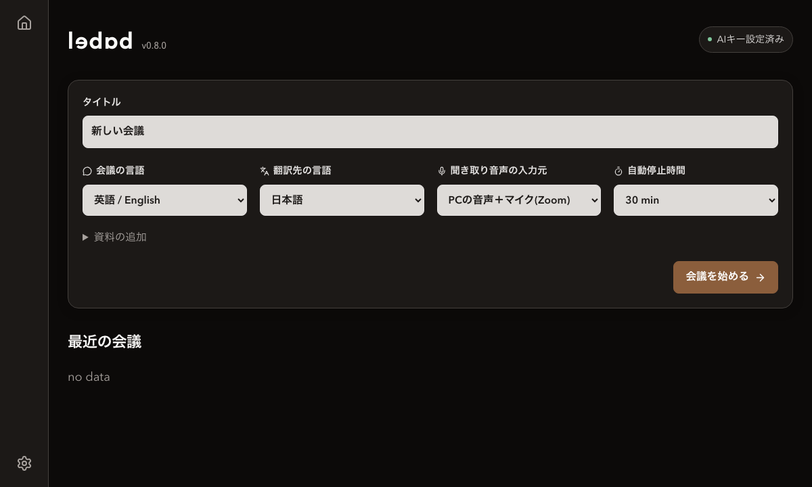

# ledad

[日本語](README.ja.md) | [English](README.md) | [中文（简体）](README.zh.md) | [Français](README.fr.md)

Une application Mac qui transcrit et traduit les réunions en temps réel. L’IA vous aide à comprendre les échanges et à intervenir : suivez la conversation, consultez l’IA et faites lire vos propositions à voix haute.

Démonstration de l’interface avec une conversation fictive.

Technologies : Next.js 16, React 19, TypeScript, Python, Tauri 2, Swift, API OpenAI, API Gemini et Apple SpeechTranscriber.

Next.js gère l’interface et la transmission audio en temps réel, tandis que Python gère les données des réunions et les traitements d’IA. Tauri et Swift assurent l’intégration native à macOS et la capture audio.

## Fonctionnalités

- Entrée audio depuis le micro, le PC ou les deux
- Transcription et traduction Live à faible latence, puis résultats Fixed par réanalyse de l’audio enregistré
- Affichage des sujets et des mentions, questions et demandes vous concernant
- Consultation de l’IA selon le contexte de la réunion (Chat) et préparation de prises de parole (Ask)
- Lecture à voix haute des propositions vérifiées, avec pause et reprise
- Création d’un texte de référence et d’un glossaire à partir de PDF, PowerPoint, images et textes
- Consultation des sources du glossaire et utilisation de 100 termes maximum issus des documents et de l’analyse comme indices de reconnaissance vocale (sauf Apple Live)
- Enregistrement des données et résumés des réunions, et export des comptes rendus en Markdown
- Interface et voix en japonais, anglais, chinois simplifié et français
- Apparence claire, sombre ou selon le système, dans une palette moka

## Prérequis

- Mac avec puce Apple Silicon, sous macOS 26 ou ultérieur
- Clé API OpenAI (Gemini est facultatif)
- [LibreOffice](https://www.libreoffice.org/download/download-libreoffice/) pour la conversion des fichiers PowerPoint

## Installation

### Installer l’application

1. Téléchargez [v0.9.1 pour Apple Silicon](https://github.com/uotian/ledad-app/releases/download/v0.9.1/ledad_0.9.1_aarch64.dmg) ([SHA-256](https://github.com/uotian/ledad-app/releases/download/v0.9.1/ledad_0.9.1_aarch64.dmg.sha256)). Consultez [Releases](https://github.com/uotian/ledad-app/releases/latest) pour la dernière version.
2. Ouvrez le DMG et faites glisser `ledad.app` dans le dossier Applications.
3. Ouvrez `ledad.app` depuis Applications.

L’application incluse est signée avec Apple Development ; le DMG lui-même n’est ni signé ni notarié, et macOS peut bloquer l’ouverture de l’application.

Si macOS bloque cette application dont vous avez vérifié la provenance, fermez l’alerte, puis ouvrez **Réglages Système → Confidentialité et sécurité → Ouvrir quand même**. Consultez les [instructions Apple](https://support.apple.com/fr-fr/102445).

### Enregistrer les clés API

Ajoutez votre clé API OpenAI dans Réglages → IA. Pour utiliser également Gemini, cochez l’option Gemini et ajoutez sa clé.

Une `base_url` personnalisée compatible avec OpenAI permet de traiter le texte et l’audio via ce point de connexion. Dans ce cas, la transcription Live utilise Apple et Gemini est désactivé. Le serveur doit prendre en charge les modèles et formats API existants ; voir les [conditions de connexion](docs/design/05-ai/02-connection.md).

### Autoriser l’accès audio

Au premier démarrage d’une réunion, autorisez l’accès au micro et à l’audio système. Si vous avez refusé, autorisez ledad dans Réglages Système → Confidentialité et sécurité → Microphone / Enregistrement de l’écran et de l’audio système, puis redémarrez l’application si cela vous est demandé.

## Utilisation

1. Dans l’accueil, choisissez la source audio et les langues, puis cliquez sur Démarrer une réunion.
2. Suivez la transcription et la traduction, consultez l’IA, puis préparez et faites lire vos prises de parole.
3. Utilisez Arrêter l’écoute et Reprendre pour contrôler l’écoute. Choisissez Terminer pour enregistrer et résumer la réunion.

## Traitement des données

L’application fonctionne localement et stocke les données des réunions sur votre Mac. SpeechTranscriber d’Apple transcrit également sur l’appareil, sans envoyer l’audio à reconnaître aux serveurs Apple. [Documentation Apple](https://developer.apple.com/documentation/speech/asking-permission-to-use-speech-recognition)

### À propos des services d’IA externes

L’audio, les conversations, les documents et les autres données nécessaires au traitement sont transmis à l’API OpenAI ou Gemini. Leur traitement par le destinataire dépend des conditions et des paramètres de chaque service.

#### Utiliser uniquement OpenAI

- **Entraînement et amélioration** : par défaut, les données de l’API ne servent pas à entraîner ou améliorer les modèles. Le consentement explicite au partage des données auprès d’OpenAI constitue une exception.
- **Conservation pour la surveillance** : les journaux de surveillance des abus sont normalement conservés jusqu’à 30 jours. Toutefois, selon les paramètres et les conditions applicables chez OpenAI, il peut être possible de désactiver la conservation des données pour la surveillance des abus.

#### Utiliser également Gemini

Les conditions suivantes s’appliquent aussi aux fonctions utilisant Gemini.

- **Entraînement et amélioration** : les services payants n’utilisent pas les entrées et les sorties pour entraîner ou améliorer les modèles. Les services gratuits les utilisent en principe pour l’entraînement et l’amélioration.
- **Conservation pour la surveillance** : les entrées, le contexte supplémentaire et les sorties sont conservés pendant 55 jours, notamment pour surveiller les abus. Cette conservation s’applique également aux services payants.

Ces indications reposent sur les documents officiels consultés le 18 octobre 2026. Consultez les liens ci-dessous pour connaître les conditions en vigueur.

- [API OpenAI : traitement des données](https://developers.openai.com/api/docs/guides/your-data)
- [API Gemini : conditions d’utilisation](https://ai.google.dev/gemini-api/terms)
- [API Gemini : surveillance des abus](https://ai.google.dev/gemini-api/docs/usage-policies)

Si vous configurez un point de connexion personnalisé (`base_url`), ses règles de traitement des données s’appliquent.

## Remarques

- Cette application est développée en vibe coding avec Codex.
- L’utilisation des API OpenAI et Gemini est facturée. Le coût affiché est une estimation.
- L’écoute s’arrête automatiquement après 30 minutes par défaut (durée réglable). Choisissez Reprendre pour continuer.
- Pour transmettre la voix générée dans Zoom ou une autre application, configurez séparément le partage audio.

## Documentation

[Notes de conception (japonais, en cours de rédaction)](docs/design/00-overview.md)

## Historique des versions

Consultez l’[historique des versions](CHANGELOG.md).

## Licence

[MIT](LICENSE)
