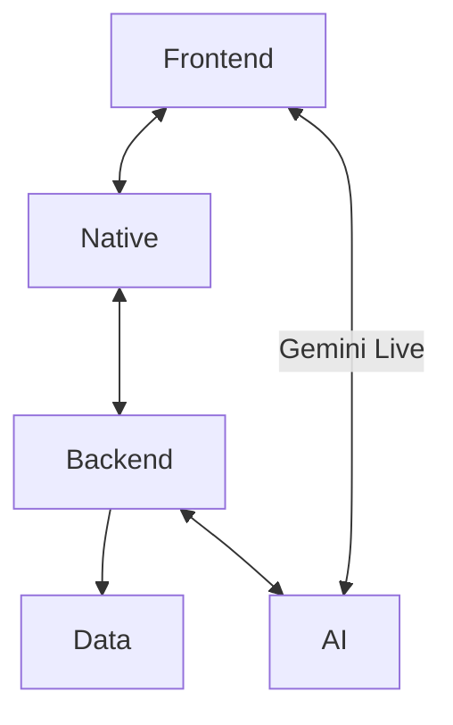

# 01 Architecture

[Design Overview](../00-overview.md) / [通信](01-communication.md)

## 構成

Ledadは、Next.js・Python・Tauri・Swiftで構成するMacアプリです。AI処理にはOpenAIとGeminiを利用します。

## レイヤー

### [Frontend](../02-frontend/00-overview.md)

Next.jsで画面とユーザー操作を制御します。

- ホーム・会議・記録・設定画面の表示
- ユーザー入力の受付と画面の状態管理
- 音声の送信・再生とAI応答の表示
- Gemini Liveへの直接接続と音声の逐次送信

### [Backend](../03-backend/00-overview.md)

Pythonで会議の操作を処理します。

- 入力の検証と会議の状態更新
- AIの呼び出し（Fixed文字起こし・翻訳・要約・発言案・チャットなど）
- Gemini Live接続用の一時トークン発行
- データの読み書き

### [Native](../04-native/00-overview.md)

TauriとSwiftでMacアプリを動かし、OS機能につなぎます。

- ウィンドウとBackendの起動・終了管理
- KeychainによるAPIキーの管理
- マイク・PC音声の取得とAppleの文字起こし

### [AI](../05-ai/00-overview.md)

OpenAIとGeminiで会議を支援するAI処理を行います。

- 文字起こし・翻訳・要約
- 発言案・チャット応答・音声の生成
- 用途ごとのモデル・入力情報・出力形式の定義

### [Data](../06-data/00-overview.md)

会議データの構造と保存方法を定めます。

- 会議・資料・会話・生成結果の構造と関連の定義
- JSONと関連ファイルによるローカル保存
- データの更新・削除ルールの管理
