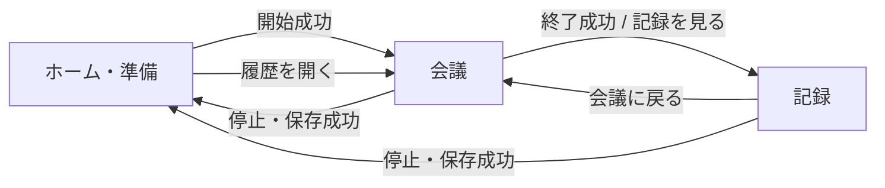

# 02.05 画面遷移

[Frontend](00-overview.md)

URLで会議を識別し、会議の状態とユーザー操作で画面を切り替えます。

## URLと表示

| URL・状態                           | 表示                           |
| ----------------------------------- | ------------------------------ |
| `/`                                 | 新しい会議の準備を行うホーム   |
| `/session/`でIDなし                 | 会議が指定されていない旨を表示 |
| `/session/?id=<会議ID>`で読み込み中 | 読み込み状態。失敗時はエラー   |
| 会議が準備中                        | ホームの会議設定               |
| 会議が進行中または終了済み          | 会議画面                       |
| 記録を開く操作                      | 記録画面。URLは会議と同じ      |

記録画面・資料モーダル・AIサポートのタブ・設定ダイアログの表示状態は、再読み込みで初期状態に戻ります。

## 遷移の流れ

- 会議開始時は編集内容を保存し、音声入力と認識を開始してから会議を開始状態に保存します。
- 開始成功後に会議画面へ切り替え、会議IDをURLへ反映します。画面の再初期化は行いません。
- 開始失敗時は音声入力を停止し、現在の画面にエラーを表示します。
- 別の会議を開くときやホームへ戻るときは、実行中の処理を停止して保存完了を待ちます。
- 保存失敗時は現在の画面と編集内容を保持します。
- 会議終了に成功すると記録画面へ進みます。ホーム移動やアプリ終了では会議の状態を変更しません。
- 会議を読み込むと、前回の再生中の発話は中断、処理中の相談は失敗として扱います。音声は自動再開しません。

## モーダル

すべてのモーダルは外側をクリックすると閉じます。内側から外側へのドラッグでは閉じません。API詳細を閉じると元の履歴に戻ります。処理中の表示を閉じても、実行中の保存・登録などは継続します。

## Loading

- 会議開始、画面移動前の保存、会議の削除、開始前の資料の登録・削除中に表示します。会議中の資料更新は[資料ボタン](03-meeting/01.01-documents.md)に進行状況を表示します。
- スピナーと「処理中」を表示し、待機表示への自動フォーカスでは輪郭線を描きません。通常の操作要素のフォーカス表示は維持します。
- 表示中はサイドバーを含む画面操作を防ぎます。Escapeでは閉じませんが、外側クリックで表示を閉じられます。同じ処理の二重実行は表示を閉じた後も防ぎます。
- 完了・取消・失敗時に閉じます。保存失敗時は現在の画面と編集内容を保持します。
- 入力中の自動保存では表示しません。

URLへの状態保存とブラウザ履歴の扱いは[Q-05](../99_課題.md)で検討します。
