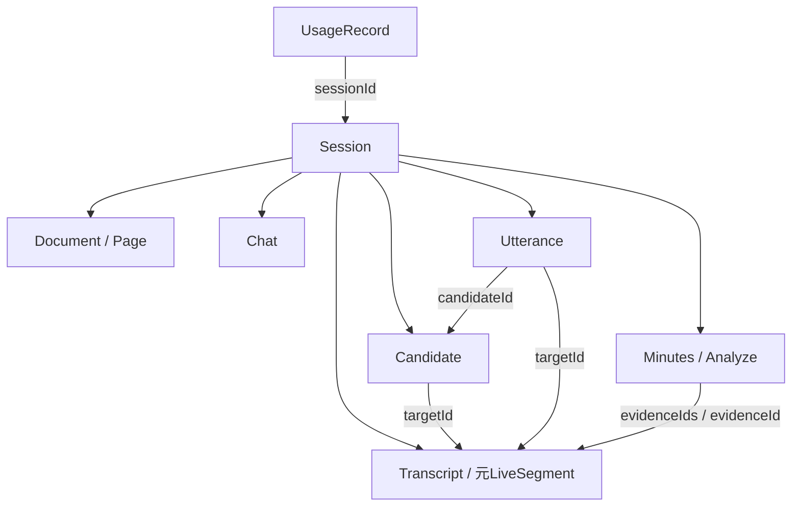

# 06.02 データの関連と意味

[Data](00-overview.md) / [スキーマ](01-schema.md)

## データの関連

会議が資料・会話・生成結果を所有し、IDで互いの関連を保持します。

- 発言案から、根拠となる資料・発言を参照します。
- 実際の発話を、元の発言案と対応付けます。
- Fixedへ統合した後も、元LiveのID・原文・時刻を保持します。

| 関係                                | 保持する意味                                                   |
| ----------------------------------- | -------------------------------------------------------------- |
| Session → documents / transcripts等 | 一つの会議の記録が各要素を所有する                             |
| Candidate → targetId                | どの発言に対する候補か。対象なしの発言案もある                 |
| Utterance → Candidate               | どの候補を実際に再生したか。再生開始時の文面は別途コピーする   |
| Transcript → liveSegments           | Fixedへ置き換えた元LiveのID・原文・時刻・扱い                  |
| 要約 / 会話分析 → 根拠ID            | 会話・発話のどの記録を材料としたか。出力種別で参照範囲が異なる |
| UsageRecord → Session               | どの会議のAI利用か。会議削除後も台帳が残る場合がある           |

発言の検索では元LiveのIDも対象とし、Fixedへの統合後も候補との対応を保ちます。

## 会議の事実と派生情報

会議の根拠は、聞き取った発言と再生完了を確認した発話区間です。未発話の候補と私的なChatは除きます。中断したUtteranceは完了区間と中断の注記を渡し、資料は別の入力として扱います。

## 時刻

`meetingStartedAt` / `meetingLastAt`は、空でないTranscript・元LiveSegment・完了文章を持つUtteranceの有効な時刻から求めます。翻訳やChat、要約だけの更新では会話範囲を延ばしません。

`startedAt` / `endedAt`は操作の履歴、`updatedAt`は記録全体の変更時刻です。履歴には最初の発言日時と、最初から最後の発言までの経過時間を表示します。
