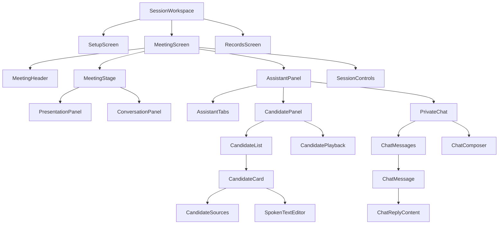
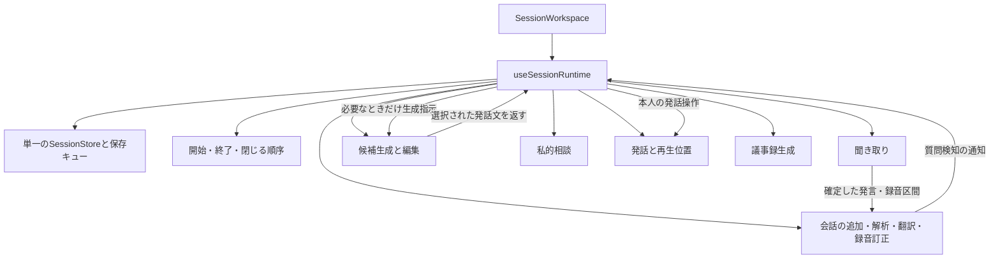

# ledadのパッケージとファイル構成の設計案

2026年10月5日。現在の作業ツリーを対象に、画面と処理の構成を10回の観点で練り直した設計案です。実装を移動・分割した記録ではありません。既存の構成整理の報告とは分けています。

採用する方針は、**画面は見える包含関係、処理は仕事の包含関係に沿って深く置き、その場所だけで理解・変更できる範囲を増やす**ことです。画面専用の状態、表示整形、CSS、翻訳文、テストも持ち主の近くへ置きます。単に `components`、`hooks`、`ai` に分類し直す案は採用しません。

ただし「必ず1ファイルだけ変更すればよい」とはしません。表示だけの変更は表示部品、候補生成の変更は候補生成のまとまり、公開範囲の変更は公開ルールが所有します。通信や保存形式を変える場合の複数箇所の修正は必要です。その変更箇所を予測可能にし、同じ判断の重複をなくすことを目標にします。

## 10回の検討と改良

各回で前案に具体的な変更を当てはめ、見つかった弱点を次の案へ反映しました。以下は設計の比較・改訂記録であり、10回の動作テストを行ったという意味ではありません。

| 回 | 試した構成と問題 | 改良して残した判断 |
| --- | --- | --- |
| 1 | 前回答の `client / service / shared` を最上位にする案。候補生成の変更を追うだけでも分類間を往復する。 | 主語を仕事へ変更。`session/candidates` に候補生成の要求・応答・処理をまとめ、実行場所は `.client.ts`、`.server.ts` で明示する。 |
| 2 | UIを `meeting/candidates` と `meeting/chat` に並べる案。実際には両方とも `AssistantPanel` の子で、ファイルから画面を再現しにくい。 | `meeting/assistant/candidates/list/card` と `meeting/assistant/chat/messages/message/reply` へ包含関係を反映する。装飾用の全DOM要素をフォルダにはしない。 |
| 3 | 関連処理もすべて末端パネルへ入れる案。タブ非表示・画面切替と、聞き取り・返信待ちの寿命が混ざる。 | UI専用状態はパーツへ、会議中の処理は `session` へ。`SessionWorkspace` が会議ランタイムを一度だけ作る。タブの表示だけでは処理を破棄しない。 |
| 4 | すべてを最初の利用画面の下へ置く案。現在 `PdfSlide` は会議と共有、`SettingsDialog` はホームとサイドバー、`BrandMark` はサイドバーと共有が使っている。 | 実際に複数の利用者がある部品だけ、資料表示・アプリ設定・ブランドという共通の持ち主へ引き上げる。共有画面から会議画面の内部をimportしない。 |
| 5 | 既存TSXをそのまま移す案。`CandidatePanel` は候補選択・編集の状態更新と再生操作、`PrivateChat` は入力・IME・自動伸縮・一覧・返信表示を持ち続ける。 | 親TSXは子の組み立てと接続へ絞る。編集は候補の操作、IMEと入力はcomposer、Markdown表示はreplyが所有する。単なる一行の要素までファイル化しない。 |
| 6 | `session` の下に再び巨大な `ai`、`hooks` を作る案。生成受付とプロンプトの距離が元に戻る。 | `candidates`、`consultation`、`conversation/refinement`、`speech` ごとに処理を集約する。SDK通信と失敗時の共通処理だけ `platform/providers` に置く。 |
| 7 | 各機能が独自にSessionを保存する案と、すべての画面に汎用 `store.update` を渡す案。保存競合か、画面ごとの更新ルールの重複が起こる。 | 保存キューの所有者は `session/store` 一つ。画面は `editCandidate` 等の意味のある操作を呼ぶ。保存スキーマは合成の中心に保ち、公開可否は `session/privacy`、共有用の射影は `session/sharing` へ分ける。 |
| 8 | 「AIはすべてNode.js経由」とする単純な層構成。現在のLive接続はWebViewからGeminiへ直接接続するため実装と一致しない。 | Live接続は `session/listening/live`、一時トークン発行は同じ場所のserver処理。Rustは通信・OS操作を担当し、APIキー待機の操作名一覧は持たせない。Node.js側のキー準備を共通の待機処理にする。モデルと推論量の相談専用判定も共通OpenAI処理から相談側へ戻す。 |
| 9 | TSXとTSだけを近づける案。CSS、約1500行の翻訳辞書、テスト、Swift、ビルドの入口が離れたまま。 | 固有CSSと辞書と単体テストを所有者へ寄せる。複数画面のE2Eは独立して維持。Swiftは音声取得内の責務で分け、既存のビルド入口から明示的に集める。 |
| 10 | 分割数を増やし続ける案。1ファイルだけの中継フォルダ、全階層のindex、汎用Repository、使われない将来用interfaceが増える。 | 変更例で最終確認し、薄い中継は作らない。155行の保存スキーマはまず1ファイルのまま、小さいRustモジュールも維持。共有窓は `share_window.rs` 一つとし、単なる再公開用のフォルダを作らない。フォルダの深さとファイル数を目的にしない。 |

## 配置を決めるルール

1. **最初は利用者のそばへ置く。** `CandidateCard` 専用の整形関数やテストは同じ `card/` に置きます。
2. **フォルダは持ち主を表す。** `assistant/candidates/list/card` は「サポート欄の候補一覧のカード」です。`common/utils/helpers` のような持ち主のない分類を作りません。
3. **親は組み立て、子は自分の責務を実行する。** 親に子の入力処理・候補の編集規則・描画の細部を戻しません。一方、開始・終了の順序など複数の仕事を調整する責任は親に残します。
4. **共有は実際の利用者で決める。** 複数の画面が同じ意味で使うものは共通の持ち主へ引き上げます。似た見た目だけを理由に、候補の発話ボタンと聞き取り停止ボタンを統合しません。
5. **画面の階層と処理の寿命を区別する。** 小さなTSXへ音声接続の所有権を渡しません。処理を置く場所は `session/listening`、開始・終了を調整する場所は `session/lifecycle` です。
6. **ファイル名から仕事と実行場所を読めるようにする。** `generate.server.ts` はNode.jsの候補生成、`candidates.client.ts` は画面側の通信、`contract.ts` は両側で共有する入出力です。実行場所が自明なTSXや純粋関数にまで接尾辞を強制しません。
7. **最小責務は最小行数ではない。** カード本文とその見出しを一つの表示責務として扱えます。根拠資料の一覧と発話文の編集欄は変更理由が異なるため、カードの子にします。独立した変更理由、状態、入出力が生じたら分けます。全コンポーネントへのHook・型ファイル・CSSの機械的な三点セットは作りません。
8. **コメントは日本語で理由と制約を書く。** 例は「タブを隠しても下書きを保持する」「停止前に届いた録音の再認識は待つ」です。コードの逐語訳、英語の定型コメント、古い仕様の説明は増やしません。識別子や外部APIの正式名は英語のまま扱えます。

## 画面の包含関係



矢印は表示部品の包含関係です。会議の音声接続や生成処理の所有者を表すものではありません。`MeetingStage` は現在の左列、`AssistantPanel` は右列です。構造を維持したまま、画面の大きな領域から末端部品へ辿れます。

## 会議処理の所有関係



この図は調整の方向です。候補処理がチャットUIや発話UIを直接呼ぶ構造にはしません。ランタイムは必要なデータと操作を各パネルへ渡し、画面には巨大な `Meeting` 全体や `SessionStore.update` を配りません。共通Storeを各機能で作り直すこともしません。

`useConversation` は解析と翻訳と訂正をまとめる境界です。速報・暫定訳・確定訳・録音訂正の整合性をこの下へ閉じ込め、`useSessionRuntime` に細かな差し替えロジックを戻しません。`useSessionLifecycle` は処理の終了順序を所有し、個々の処理の内部状態は所有しません。

## 状態をどこへ置くか

| 状態 | 所有者 | 保持する範囲 |
| --- | --- | --- |
| 会議・資料・原稿・確定した会話・相談履歴 | `session/store/useSessionStore.ts` | 同じ会議IDのWorkspaceと永続保存 |
| 聞き取り接続・入力機器・接続更新・自動停止 | `session/listening/useListening.ts` 以下 | 明示的な入力停止または会議終了まで |
| 速報・暫定訳・解析中の要求・録音訂正 | `session/conversation/useConversation.ts` 以下 | 対象会議の処理として管理。停止済み音声の訂正は完了を待つ |
| 選択中の候補・生成中の要求 | `session/candidates/useCandidates.ts` | タブ切替や画面の再描画では破棄しない |
| 発話位置・中断位置・再生記録 | `session/speech/useSpeech.ts` 以下 | 発話停止と入力停止を分離して管理 |
| 相談の返信待ち | `session/consultation/useConsultation.ts` | 入力停止では取り消さず、会議終了の方針に従う |
| チャットの未送信文章 | `chat/PrivateChat.tsx` | 入力欄と提案文ボタンが共有するため、その親が所有。タブ非表示中も保持 |
| IME・入力欄の高さ | `chat/composer/` | 入力欄だけ。既存と同様に両タブをマウントしておく |
| タブ選択 | `assistant/AssistantPanel.tsx` | サポート欄内。外側の画面に特別な利用者がなければ上げない |
| スクロール追従 | 各一覧部品 | その一覧だけ |
| 表示言語・文字サイズ・配色 | `application/preferences/` | アプリ全体。設定ダイアログを閉じても残る |

提案文ボタンも現在は送信後に下書きを消すため、未送信文章をcomposerだけに閉じ込めると兄弟間の操作が必要になります。そこで共通の親である `PrivateChat` に置き、入力欄には値と変更操作を渡します。

タブを条件付きレンダリングに変える場合は、入力状態を `AssistantPanel` へ引き上げる必要があります。この案では現行の非表示方式を維持し、その追加変更を不要にします。

## 一つのファイルに残す責務

| ファイル | このファイルが所有すること | 渡された操作に任せること |
| --- | --- | --- |
| `MeetingScreen.tsx` | ヘッダー・左列・右列・操作欄の配置 | 生成・音声接続・保存 |
| `AssistantPanel.tsx` | タブ選択と子パネルの表示維持 | 候補の編集・相談送信・音声再生 |
| `CandidatePanel.tsx` | 対象質問・候補一覧・操作欄の組み立て | 候補の配列更新・発話開始 |
| `CandidateCard.tsx` | 一つの候補の本文・選択状態と子部品の組み立て | 根拠一覧の詳細・編集入力・保存規則 |
| `CandidateSources.tsx` | 根拠資料名とページと引用の表示 | 公開可否の決定・資料取得 |
| `SpokenTextEditor.tsx` | 発話文の編集入力 | 保存規則・他の候補の状態更新 |
| `CandidatePlayback.tsx` | 発話・一時停止・再開の操作表示 | 再生位置と音声ファイルの管理 |
| `PrivateChat.tsx` | 一覧・提案文・入力欄の接続と、共通の下書きの所有 | 返信の通信・会議データの保存 |
| `ChatComposer.tsx` と隣のHook | 渡された文章の入力表示、IME・高さ調整 | 相談の履歴追加と返信処理 |
| `ChatReplyContent.tsx` | 安全なMarkdown表示 | 返信生成・リンク先への外部操作 |
| `ApiKeySettings.tsx` と隣のHook | APIキー入力・保存中の状態・登録状態表示 | キーチェーンアクセスとサービスへの反映 |
| `useSessionRuntime.ts` | 各処理を一度生成し、質問検知や本人の操作を接続する | 個別処理のアルゴリズム・停止内部処理 |
| `useSessionLifecycle.ts` | 開始・終了・閉じる・保存の順序を調整する | PCM処理・翻訳内容・候補編集 |
| `applyRefinement.ts` | 元の発言と録音訂正を照合して、新しい会話データを返す | 音声取得・通信・React更新・保存 |
| `generate.server.ts` | 候補生成の段取りと出力の確認 | HTTPの解読、SDK共通処理、画面更新 |
| `repository.server.ts` | 保存ファイルの読み書きと置換 | 画面遷移・生成の方針 |

たとえば `CandidateCard` に渡すのは候補、選択状態、選択・編集の操作です。会議全体や汎用Storeは渡しません。親TSXに子の仕事を全部押し出して行数だけ減らす分割も避けます。

## 入出力と依存関係のルール

- `app` はルートの入口です。Next.jsが要求するファイル名を保ち、画面は `screens` へ委譲します。
- `screens` は `session` の公開操作、`application` の設定、`ui` の共通表示を使います。兄弟画面の私有ファイルを参照しません。
- `session` の処理から `screens` を参照しません。表示言語はランタイム作成時に引数で渡します。現在の `useMeeting` から設定画面配下のProviderを参照する依存を解消します。
- `.client.ts`、TSX、Hookから `.server.ts`、Node.js標準API、秘密キー設定を参照しません。`.server.ts` からReact Hookや画面部品も参照しません。
- `contract.ts` はその機能の入出力だけです。Zod・純粋な型への依存に限り、Provider SDK、ファイル操作、HTTP、Reactを含めません。返却型の手書きの二重管理を減らします。Live接続設定のようなSDK固有の値は、この境界で必要なデータ形式を定義し、接続側でSDK型へ対応付けます。
- Sessionの保存スキーマとAPIの要求・応答は別の責務です。既存の保存キー、旧データ補正、料金スナップショットをこの構成変更に便乗して変えません。
- `session/privacy/documents.ts` が資料の利用・開示可否、`session/privacy/meetingEvidence.ts` が実際の会議発言、`session/sharing/publicView.ts` が共有画面へ渡す情報を所有します。私的相談の入力と公開候補の入力を一つの共通コンテキスト生成へまとめません。
- `service/dispatch.ts` は操作の登録・振り分けだけを扱います。新しいAPIの追加では登録変更が必要です。自動探索、独自DIコンテナ、全ファイルを再公開するindexは導入しません。
- SDKの共通クライアント生成とOpenAIの構造化応答は `platform/providers`、機能固有のGemini要求はLiveトークン・音声生成・録音再認識の所有者、使用量の記録は `usage` が担当します。依存は `platform/providers → usage` とし、`usage` がProvider処理を呼び戻す循環を作りません。エラーの安全な記録用抽出は `usage/server` に置きます。

現在のOpenAI共通処理は処理名が相談かどうかでモデルと推論量を切り替えています。この判断は `session/consultation/server/reply.server.ts` へ移し、共通処理にはオプションとして渡します。全機能で使う既定モデルの環境設定は共通に保ち、機能ごとに同じ既定値をコピーしません。Geminiの認識・読み上げのモデル選択も各機能が所有し、設定画面用の一覧はserver側でその公開設定を集めます。

機械的な制約は、移行時にESLintのimport制限で補います。現時点のESLintはこの境界を強制していないため、配置を変えただけで守られるとは扱いません。client/server間の一括再exportは禁止し、純粋な型・定数を介した間接importも実際の依存グラフで確認します。

## CSSと翻訳とテストの配置

部品固有のCSSはその部品のフォルダへCSS Modulesとして置き、部品自身がimportします。これにより、固有スタイルを追加するたびに中央のCSS一覧を更新する必要がなくなります。画面全体の列配置だけ `meeting.module.css` など親が所有し、配色トークンと基本スタイルは `application/styles` に残します。幅に応じた子部品の変化も子のCSSに含め、巨大な `responsive.css` へ集め直しません。親のCSSから子の内部クラスを指定せず、子が公開する属性・propsで表示状態を渡します。既存のグローバルなカスケードを移す際には見た目の確認が必要です。CSS Modulesの扱いはインストール済みNext.jsの `node_modules/next/dist/docs/01-app/01-getting-started/11-css.md` を確認しました。

`messages.ts` は画面または意味のあるパネル単位に置きます。小さい部品ごとに空に近い辞書を作りません。共通の「保存」「取消」などは `application/preferences/language/messages.ts` に限り、機能固有の文章を追加しません。翻訳の仕組みはアプリのProviderが持ち、各パネルが自分の辞書を渡す方式にします。中央の全辞書登録ファイルを更新する方式は避けます。業務エラーの表示文は、発生元の意味を保ち、移行中は既存の日本語エラーと表示側翻訳の対応を維持します。

単体テストはテスト対象の隣へ移します。Vitestの現在の対象は `tests/**/*.test.ts` なので、`src/**/*.test.ts` を追加し、統合テストも実行対象に残す設定変更が必要です。TSXの配置変更だけを検査する単体テストは量産しません。UIの状態保持・操作の意味は既存のPlaywrightテストで検証します。現行の翻訳テストは `src/components` と単一辞書を探索しているため、移行先の画面・共通部品と各辞書の対応を検査するよう更新します。検査対象が0件になって成功することも防ぎます。実API・ローカルHTTP・複数処理を通すテストは `tests/integration`、画面全体のテストは `tests/e2e` に残します。

## 実行場所とMac固有処理

`session/listening/live/LiveTranscription.ts` はWebView上で動きます。`token.server.ts` が発行する一時トークンを使ってGeminiへ直接接続します。通常の生成・相談・翻訳・録音再認識・音声生成は、各機能のserver処理からNode.js上で実行します。

`service/main.ts` と `service/dev-server.ts` は同じdispatchへ入る別の通信入口です。本番の標準入出力と開発用HTTPを独立した業務実装にしません。サービスのキー初期化完了はNode.js側で管理し、Provider呼び出しと設定確認が同じ待機処理を使います。会議一覧・資料保存はキー待機を要求しません。デスクトップはinit受信、開発用HTTPは環境設定の読み込みで準備完了とし、初期化失敗やタイムアウトも呼び出し元へ返します。RustからAPIパスの種類による待機判定を外せば、新しい生成APIごとにRustの一覧も直す必要がなくなります。

Rustは起動・終了、ウィンドウ権限、キーチェーン、Node.jsとSwiftのプロセス管理を所有します。共有ウィンドウからの操作制限はRustに残します。Node.jsへ権限チェックを全部移すという意味ではありません。現在の `lib.rs` 内の共有窓・終了・キー保存・サービス仲介の各コマンドを、その仕事を所有するRustファイルへ移します。

Swiftは `native/audio/main.swift` が入力元を選び、`system/SystemCapture.swift` と `microphone/MicrophoneCapture.swift` が各取得方式を持ちます。PCM変換とイベント出力は両者の共通の親に置きます。JavaScript側の `NativeCapture` とSwift側を物理的に一つのフォルダへ混在させず、言語のビルド境界を維持します。

`public/audio/pcm-processor.js` はブラウザから固定URLで読み込むため、そのまま残す例外です。`scripts/prepare-desktop.mjs` も既存のビルド入口として残し、Swiftの入力ファイル一覧とサービスの依存先を更新します。構成変更だけを理由に、npm workspacesやRust workspaceを追加しません。

## ファイル単位の最終構成案

以下は移行後の配置案です。現在存在するファイル名と新たに分割するファイル名を含みます。外部ライブラリ、生成物、画像資産、既存の文書はこのツリーの列挙対象外です。単体テストは実際に責務を検証するものだけを既存テストから移します。

```text
ledad/
├─ native/
│  └─ audio/
│     ├─ microphone/
│     │  └─ MicrophoneCapture.swift
│     ├─ system/
│     │  └─ SystemCapture.swift
│     ├─ PcmOutput.swift
│     ├─ events.swift
│     └─ main.swift
├─ public/
│  └─ audio/
│     └─ pcm-processor.js
├─ scripts/
│  ├─ check-service.mjs
│  ├─ dev.mjs
│  ├─ prepare-desktop.mjs
│  ├─ probe-models.mjs
│  ├─ probe-services.ts
│  ├─ sign-macos.mjs
│  └─ verify-languages.ts
├─ src/
│  ├─ app/
│  │  ├─ session/
│  │  │  ├─ SessionRoute.tsx
│  │  │  └─ page.tsx
│  │  ├─ share/
│  │  │  ├─ ShareRoute.tsx
│  │  │  └─ page.tsx
│  │  ├─ globals.css
│  │  ├─ layout.tsx
│  │  └─ page.tsx
│  ├─ application/
│  │  ├─ brand/
│  │  │  └─ BrandMark.tsx
│  │  ├─ preferences/
│  │  │  ├─ language/
│  │  │  │  ├─ LanguageProvider.tsx
│  │  │  │  ├─ locale.test.ts
│  │  │  │  ├─ locale.ts
│  │  │  │  ├─ messages.ts
│  │  │  │  └─ useI18n.ts
│  │  │  ├─ text-size/
│  │  │  │  └─ TextSizeProvider.tsx
│  │  │  └─ theme/
│  │  │     ├─ ThemeInitializer.tsx
│  │  │     └─ theme.ts
│  │  ├─ settings/
│  │  │  ├─ credentials/
│  │  │  │  ├─ ApiKeySettings.tsx
│  │  │  │  └─ useApiKeys.ts
│  │  │  ├─ display/
│  │  │  │  ├─ appearance/
│  │  │  │  │  └─ AppearanceSettings.tsx
│  │  │  │  ├─ language/
│  │  │  │  │  └─ LanguageSettings.tsx
│  │  │  │  ├─ text-size/
│  │  │  │  │  └─ TextSizeSettings.tsx
│  │  │  │  └─ DisplaySettings.tsx
│  │  │  ├─ SettingsDialog.tsx
│  │  │  ├─ messages.ts
│  │  │  └─ settings.module.css
│  │  ├─ shell/
│  │  │  ├─ sidebar/
│  │  │  │  ├─ brand/
│  │  │  │  │  └─ Brand.tsx
│  │  │  │  ├─ home/
│  │  │  │  │  └─ HomeLink.tsx
│  │  │  │  ├─ settings/
│  │  │  │  │  └─ SettingsButton.tsx
│  │  │  │  └─ Sidebar.tsx
│  │  │  ├─ AppShell.tsx
│  │  │  ├─ shell.module.css
│  │  │  └─ useAppClose.ts
│  │  └─ styles/
│  │     ├─ base.css
│  │     └─ tokens.css
│  ├─ platform/
│  │  ├─ audio/
│  │  │  ├─ wav.test.ts
│  │  │  └─ wav.ts
│  │  ├─ config/
│  │  │  ├─ config.client.ts
│  │  │  ├─ config.server.ts
│  │  │  ├─ contract.ts
│  │  │  ├─ credentials-ready.server.ts
│  │  │  └─ handler.server.ts
│  │  ├─ desktop/
│  │  │  ├─ files.client.ts
│  │  │  └─ invoke.client.ts
│  │  ├─ errors/
│  │  │  └─ AppError.ts
│  │  ├─ providers/
│  │  │  ├─ gemini.server.ts
│  │  │  ├─ openai.server.ts
│  │  │  ├─ openai.test.ts
│  │  │  ├─ retry.server.ts
│  │  │  └─ retry.test.ts
│  │  └─ transport/
│  │     ├─ protocol.ts
│  │     ├─ request.client.ts
│  │     └─ serviceFetch.client.ts
│  ├─ screens/
│  │  ├─ home/
│  │  │  ├─ header/
│  │  │  │  └─ HomeHeader.tsx
│  │  │  ├─ hero/
│  │  │  │  ├─ art/
│  │  │  │  │  └─ HeroIllustration.tsx
│  │  │  │  └─ Hero.tsx
│  │  │  ├─ history/
│  │  │  │  ├─ item/
│  │  │  │  │  └─ SessionItem.tsx
│  │  │  │  └─ SessionList.tsx
│  │  │  ├─ mode-picker/
│  │  │  │  ├─ card/
│  │  │  │  │  └─ ModeCard.tsx
│  │  │  │  └─ ModePicker.tsx
│  │  │  ├─ HomeScreen.tsx
│  │  │  ├─ home.module.css
│  │  │  ├─ messages.ts
│  │  │  └─ useHome.ts
│  │  ├─ session/
│  │  │  ├─ meeting/
│  │  │  │  ├─ assistant/
│  │  │  │  │  ├─ candidates/
│  │  │  │  │  │  ├─ list/
│  │  │  │  │  │  │  ├─ card/
│  │  │  │  │  │  │  │  ├─ editor/
│  │  │  │  │  │  │  │  │  └─ SpokenTextEditor.tsx
│  │  │  │  │  │  │  │  ├─ sources/
│  │  │  │  │  │  │  │  │  └─ CandidateSources.tsx
│  │  │  │  │  │  │  │  ├─ CandidateCard.tsx
│  │  │  │  │  │  │  │  └─ card.module.css
│  │  │  │  │  │  │  └─ CandidateList.tsx
│  │  │  │  │  │  ├─ playback/
│  │  │  │  │  │  │  └─ CandidatePlayback.tsx
│  │  │  │  │  │  ├─ toolbar/
│  │  │  │  │  │  │  └─ CandidateToolbar.tsx
│  │  │  │  │  │  ├─ CandidatePanel.tsx
│  │  │  │  │  │  ├─ candidates.module.css
│  │  │  │  │  │  └─ messages.ts
│  │  │  │  │  ├─ chat/
│  │  │  │  │  │  ├─ composer/
│  │  │  │  │  │  │  ├─ ChatComposer.tsx
│  │  │  │  │  │  │  ├─ composer.module.css
│  │  │  │  │  │  │  └─ useChatComposer.ts
│  │  │  │  │  │  ├─ messages/
│  │  │  │  │  │  │  ├─ message/
│  │  │  │  │  │  │  │  ├─ reply/
│  │  │  │  │  │  │  │  │  ├─ ChatReplyContent.test.ts
│  │  │  │  │  │  │  │  │  └─ ChatReplyContent.tsx
│  │  │  │  │  │  │  │  └─ ChatMessage.tsx
│  │  │  │  │  │  │  └─ ChatMessages.tsx
│  │  │  │  │  │  ├─ prompts/
│  │  │  │  │  │  │  └─ ConsultationPrompts.tsx
│  │  │  │  │  │  ├─ PrivateChat.tsx
│  │  │  │  │  │  ├─ chat.module.css
│  │  │  │  │  │  └─ messages.ts
│  │  │  │  │  ├─ tabs/
│  │  │  │  │  │  └─ AssistantTabs.tsx
│  │  │  │  │  ├─ AssistantPanel.tsx
│  │  │  │  │  └─ assistant.module.css
│  │  │  │  ├─ controls/
│  │  │  │  │  ├─ listening/
│  │  │  │  │  │  ├─ InputLevelMeter.tsx
│  │  │  │  │  │  ├─ ListeningControls.tsx
│  │  │  │  │  │  ├─ ListeningElapsed.tsx
│  │  │  │  │  │  └─ listening.module.css
│  │  │  │  │  └─ SessionControls.tsx
│  │  │  │  ├─ header/
│  │  │  │  │  ├─ elapsed/
│  │  │  │  │  │  └─ MeetingElapsed.tsx
│  │  │  │  │  ├─ usage/
│  │  │  │  │  │  ├─ MeetingUsageCost.tsx
│  │  │  │  │  │  └─ useMeetingUsageCost.ts
│  │  │  │  │  ├─ MeetingHeader.tsx
│  │  │  │  │  └─ header.module.css
│  │  │  │  ├─ stage/
│  │  │  │  │  ├─ conversation/
│  │  │  │  │  │  ├─ item/
│  │  │  │  │  │  │  └─ TranscriptItem.tsx
│  │  │  │  │  │  ├─ live/
│  │  │  │  │  │  │  └─ LiveTranscript.tsx
│  │  │  │  │  │  ├─ testing/
│  │  │  │  │  │  │  └─ TestTranscriptInput.tsx
│  │  │  │  │  │  ├─ ConversationPanel.tsx
│  │  │  │  │  │  ├─ conversation.module.css
│  │  │  │  │  │  ├─ formatTranscript.ts
│  │  │  │  │  │  ├─ messages.ts
│  │  │  │  │  │  └─ useTranscriptScroll.ts
│  │  │  │  │  ├─ presentation/
│  │  │  │  │  │  ├─ controls/
│  │  │  │  │  │  │  └─ PageControls.tsx
│  │  │  │  │  │  ├─ script/
│  │  │  │  │  │  │  └─ CurrentScript.tsx
│  │  │  │  │  │  ├─ slide/
│  │  │  │  │  │  │  └─ SlidePreview.tsx
│  │  │  │  │  │  ├─ PresentationPanel.tsx
│  │  │  │  │  │  └─ presentation.module.css
│  │  │  │  │  └─ MeetingStage.tsx
│  │  │  │  ├─ MeetingScreen.tsx
│  │  │  │  ├─ meeting.module.css
│  │  │  │  └─ messages.ts
│  │  │  ├─ records/
│  │  │  │  ├─ export/
│  │  │  │  │  └─ ExportRecordButton.tsx
│  │  │  │  ├─ questions/
│  │  │  │  │  └─ QuestionRecord.tsx
│  │  │  │  ├─ sections/
│  │  │  │  │  └─ RecordSection.tsx
│  │  │  │  ├─ RecordsScreen.tsx
│  │  │  │  ├─ messages.ts
│  │  │  │  └─ records.module.css
│  │  │  ├─ setup/
│  │  │  │  ├─ audio/
│  │  │  │  │  └─ AudioSettings.tsx
│  │  │  │  ├─ documents/
│  │  │  │  │  ├─ item/
│  │  │  │  │  │  └─ DocumentItem.tsx
│  │  │  │  │  ├─ DocumentPanel.tsx
│  │  │  │  │  ├─ documents.module.css
│  │  │  │  │  └─ useDocumentUpload.ts
│  │  │  │  ├─ scripts/
│  │  │  │  │  ├─ ScriptEditor.tsx
│  │  │  │  │  ├─ scripts.module.css
│  │  │  │  │  └─ useScriptEditor.ts
│  │  │  │  ├─ SetupScreen.tsx
│  │  │  │  ├─ messages.ts
│  │  │  │  ├─ setup.module.css
│  │  │  │  └─ useSetup.ts
│  │  │  ├─ SessionWorkspace.tsx
│  │  │  └─ useSessionWorkspace.ts
│  │  └─ share/
│  │     ├─ caption/
│  │     │  └─ SharedCaption.tsx
│  │     ├─ header/
│  │     │  └─ SharedHeader.tsx
│  │     ├─ stage/
│  │     │  └─ SharedStage.tsx
│  │     ├─ SharedScreen.tsx
│  │     ├─ messages.ts
│  │     ├─ share.module.css
│  │     └─ useSharedView.ts
│  ├─ service/
│  │  ├─ dev-server.ts
│  │  ├─ dispatch.ts
│  │  ├─ http.server.ts
│  │  └─ main.ts
│  ├─ session/
│  │  ├─ candidates/
│  │  │  ├─ server/
│  │  │  │  ├─ background-guidance.ts
│  │  │  │  ├─ generate.server.ts
│  │  │  │  ├─ generate.test.ts
│  │  │  │  ├─ prompt.ts
│  │  │  │  └─ spoken-confirmation.ts
│  │  │  ├─ actions.ts
│  │  │  ├─ candidates.client.ts
│  │  │  ├─ contract.ts
│  │  │  ├─ handler.server.ts
│  │  │  └─ useCandidates.ts
│  │  ├─ consultation/
│  │  │  ├─ server/
│  │  │  │  ├─ prompt.ts
│  │  │  │  ├─ reply.server.ts
│  │  │  │  └─ reply.test.ts
│  │  │  ├─ consultation.client.ts
│  │  │  ├─ contract.ts
│  │  │  ├─ handler.server.ts
│  │  │  └─ useConsultation.ts
│  │  ├─ conversation/
│  │  │  ├─ analysis/
│  │  │  │  ├─ analysis.client.ts
│  │  │  │  ├─ analyze.server.ts
│  │  │  │  ├─ analyze.test.ts
│  │  │  │  ├─ contract.ts
│  │  │  │  └─ handler.server.ts
│  │  │  ├─ refinement/
│  │  │  │  ├─ applyRefinement.test.ts
│  │  │  │  ├─ applyRefinement.ts
│  │  │  │  ├─ contract.ts
│  │  │  │  ├─ handler.server.ts
│  │  │  │  ├─ hasTranscriptOverlap.test.ts
│  │  │  │  ├─ hasTranscriptOverlap.ts
│  │  │  │  ├─ refine.server.ts
│  │  │  │  ├─ refine.test.ts
│  │  │  │  └─ refinement.client.ts
│  │  │  ├─ translation/
│  │  │  │  ├─ contract.ts
│  │  │  │  ├─ handler.server.ts
│  │  │  │  ├─ interim-state.test.ts
│  │  │  │  ├─ interim-state.ts
│  │  │  │  ├─ translate.server.ts
│  │  │  │  ├─ translation.client.ts
│  │  │  │  ├─ useInterimTranslation.ts
│  │  │  │  └─ useTranscriptTranslation.ts
│  │  │  └─ useConversation.ts
│  │  ├─ documents/
│  │  │  ├─ viewer/
│  │  │  │  └─ PdfSlide.tsx
│  │  │  ├─ attachDocument.ts
│  │  │  ├─ contract.ts
│  │  │  ├─ documents.client.ts
│  │  │  ├─ extract.server.ts
│  │  │  ├─ handler.server.ts
│  │  │  └─ labels.ts
│  │  ├─ lifecycle/
│  │  │  └─ useSessionLifecycle.ts
│  │  ├─ listening/
│  │  │  ├─ capture/
│  │  │  │  ├─ BrowserCapture.ts
│  │  │  │  └─ NativeCapture.ts
│  │  │  ├─ clock/
│  │  │  │  ├─ TranscriptClock.test.ts
│  │  │  │  └─ TranscriptClock.ts
│  │  │  ├─ live/
│  │  │  │  ├─ LiveTranscription.test.ts
│  │  │  │  ├─ LiveTranscription.ts
│  │  │  │  ├─ LiveUsage.test.ts
│  │  │  │  ├─ LiveUsage.ts
│  │  │  │  ├─ contract.ts
│  │  │  │  ├─ handler.server.ts
│  │  │  │  ├─ token.client.ts
│  │  │  │  ├─ token.server.ts
│  │  │  │  └─ token.test.ts
│  │  │  ├─ review/
│  │  │  │  ├─ ReviewBuffer.test.ts
│  │  │  │  └─ ReviewBuffer.ts
│  │  │  ├─ MeetingListener.native.test.ts
│  │  │  ├─ MeetingListener.test.ts
│  │  │  ├─ MeetingListener.ts
│  │  │  └─ useListening.ts
│  │  ├─ model/
│  │  │  ├─ createSession.ts
│  │  │  └─ schema.ts
│  │  ├─ privacy/
│  │  │  ├─ documents.ts
│  │  │  └─ meetingEvidence.ts
│  │  ├─ records/
│  │  │  ├─ contract.ts
│  │  │  ├─ export.client.ts
│  │  │  ├─ generateMinutes.server.ts
│  │  │  ├─ handler.server.ts
│  │  │  ├─ markdown.ts
│  │  │  ├─ records.client.ts
│  │  │  └─ useMinutes.ts
│  │  ├─ scripts/
│  │  │  ├─ contract.ts
│  │  │  ├─ handler.server.ts
│  │  │  ├─ scripts.client.ts
│  │  │  ├─ scripts.ts
│  │  │  └─ translate.server.ts
│  │  ├─ sharing/
│  │  │  ├─ contract.ts
│  │  │  ├─ handler.server.ts
│  │  │  ├─ openWindow.client.ts
│  │  │  ├─ publicView.ts
│  │  │  └─ sharing.client.ts
│  │  ├─ speech/
│  │  │  ├─ MeetingSpeaker.test.ts
│  │  │  ├─ MeetingSpeaker.ts
│  │  │  ├─ contract.ts
│  │  │  ├─ handler.server.ts
│  │  │  ├─ speech.client.ts
│  │  │  ├─ splitSpeech.ts
│  │  │  ├─ synthesize.server.ts
│  │  │  ├─ synthesize.test.ts
│  │  │  └─ useSpeech.ts
│  │  ├─ store/
│  │  │  ├─ contract.ts
│  │  │  ├─ handler.server.ts
│  │  │  ├─ repository.server.ts
│  │  │  ├─ repository.test.ts
│  │  │  ├─ sessions.client.ts
│  │  │  └─ useSessionStore.ts
│  │  └─ useSessionRuntime.ts
│  ├─ ui/
│  │  ├─ button/
│  │  │  ├─ Button.tsx
│  │  │  └─ button.module.css
│  │  ├─ empty-state/
│  │  │  ├─ EmptyState.tsx
│  │  │  └─ empty-state.module.css
│  │  └─ error-banner/
│  │     ├─ ErrorBanner.tsx
│  │     ├─ error-banner.module.css
│  │     └─ messages.ts
│  └─ usage/
│     ├─ server/
│     │  ├─ measured.server.ts
│     │  ├─ provider-error-summary.test.ts
│     │  ├─ provider-error-summary.ts
│     │  ├─ provider-error.ts
│     │  ├─ repository.server.ts
│     │  └─ usage.test.ts
│     ├─ contract.ts
│     ├─ cost.test.ts
│     ├─ cost.ts
│     ├─ createRecord.ts
│     ├─ handler.server.ts
│     ├─ pricing.ts
│     ├─ schema.ts
│     └─ usage.client.ts
├─ src-tauri/
│  ├─ capabilities/
│  │  └─ default.json
│  ├─ src/
│  │  ├─ billing.rs
│  │  ├─ capture.rs
│  │  ├─ credentials.rs
│  │  ├─ lib.rs
│  │  ├─ lifecycle.rs
│  │  ├─ main.rs
│  │  ├─ menu.rs
│  │  ├─ service.rs
│  │  └─ share_window.rs
│  ├─ Cargo.lock
│  ├─ Cargo.toml
│  ├─ Info.plist
│  ├─ build.rs
│  └─ tauri.conf.json
├─ tests/
│  ├─ e2e/
│  │  ├─ assistant-tabs.spec.ts
│  │  ├─ audio-settings.spec.ts
│  │  ├─ close.spec.ts
│  │  ├─ display-settings.spec.ts
│  │  ├─ listening-controls.spec.ts
│  │  ├─ live-translation.spec.ts
│  │  ├─ meeting.spec.ts
│  │  ├─ navigation.spec.ts
│  │  ├─ refinement.spec.ts
│  │  ├─ session-resume.spec.ts
│  │  ├─ startup.spec.ts
│  │  ├─ translation-stability.spec.ts
│  │  └─ translations.spec.ts
│  ├─ fixtures/
│  │  └─ pdf.ts
│  └─ integration/
│     ├─ cost-service.test.ts
│     ├─ documents.test.ts
│     ├─ local-handlers.test.ts
│     ├─ privacy.test.ts
│     ├─ refinement-service.test.ts
│     ├─ service.test.ts
│     └─ translations.test.ts
├─ eslint.config.mjs
├─ next-env.d.ts
├─ next.config.ts
├─ package-lock.json
├─ package.json
├─ playwright.config.ts
├─ tsconfig.json
└─ vitest.config.mts
```

## 変更時に開く場所の確認

| 変更例 | 主に変更する場所 | 他の場所が必要になる条件 |
| --- | --- | --- |
| 候補カードの根拠の見せ方 | `screens/session/meeting/assistant/candidates/list/card/` | 応答に新しい情報が必要なら `session/candidates/contract.ts` も必要 |
| 相談入力欄のEnterとIMEの扱い | `screens/session/meeting/assistant/chat/composer/` | 送信操作そのものの意味を変えるなら `session/consultation` |
| 相談の回答スタイル | `session/consultation/server/prompt.ts` | 見た目の変更も含む場合のみチャットのreply表示 |
| 候補生成の背景資料の扱い | `session/candidates/server/background-guidance.ts` | 開示権限自体を変える場合は `session/privacy/documents.ts` と漏えい防止の検証 |
| 録音訂正の前後の重なり幅 | `session/listening/review/ReviewBuffer.ts` と隣のテスト | 返却形式を変える場合は `conversation/refinement` の入出力も必要 |
| 録音訂正による速報の置換規則 | `session/conversation/refinement/applyRefinement.ts` と隣のテスト | 音声の取得・表示部品・Node.jsの起動方法は変更しない |
| Gemini Liveの接続更新間隔 | `session/listening/live/LiveTranscription.ts` と隣のテスト | 新しいAPI仕様がトークン発行条件も変えるなら `token.server.ts` |
| PC音声からledad自身の音を除外 | `native/audio/system/SystemCapture.swift` | 取得イベント形式を変える場合のみRustと画面側Captureも変更 |
| 聞き取り停止ボタンの見た目 | `screens/session/meeting/controls/listening/` | 発話や相談も止める仕様へ変えるならライフサイクルの設計変更が必要 |
| 会議終了と保存待ちの順番 | `session/lifecycle/useSessionLifecycle.ts` | 対象処理の終了契約変更なら各機能の操作も変更 |
| PDFの描画修正 | `session/documents/viewer/PdfSlide.tsx` | 会議と共有の両画面を確認するが、両画面に描画実装を複製しない |
| 翻訳文や小画面時の候補欄表示 | `screens/session/meeting/assistant/candidates/` | 共通デザイントークンの変更ならアプリのstyles |
| AI単価の更新 | `usage/pricing.ts` と隣のテスト | 金額の表示形式はUI側。保存済み単価を上書きしない |
| 新しい生成APIを追加 | 対象機能の `contract / client / server` と `service/dispatch.ts` | 登録と呼び出し元の接続は必要。Rustの操作名一覧の修正は不要にする |
| 会議データに新しい保存項目を追加 | `session/model/schema.ts` と項目を所有する機能 | 旧データ補正・既定値・利用箇所の確認が必要。1ファイル完結を約束しない |

「一か所」は通常、上表の意味のあるフォルダを指します。1ファイルだけで済む変更もありますが、実装とその回帰テストが同じ場所で変わることは望ましい状態です。

## 移行順序と完了条件

設計を採用して実装する場合の手順です。今回はこの移行を実行していません。

1. **画面の親子関係だけを移す。** ファイル移動とimport更新を行い、候補・相談タブの保持、共有画面のPDF、ホームからの設定を確認します。APIや保存形式は変えません。
2. **専用の表示処理を小さくする。** 候補一覧・再生欄、チャット入力・返信、設定のAPIキー欄を分け、CSSと翻訳文を対応させます。画面幅、キーボード操作、IME、タブのフォーカスを確認します。
3. **会議ランタイムを分担する。** 単一Storeを保ったまま聞き取り・会話更新・発話・ライフサイクルへ分けます。入力停止中の生成継続、再開中の録音訂正、終了時の保存待ち、再起動で自動再生しないことを検証します。
4. **機能ごとのclientとserverを近づける。** 既存URL・応答・キャンセル・利用記録の意味を保って移します。キー準備の共通化は、保存の即時性と新しいAI操作の初期待機を別々に検証します。
5. **残りの所有者とビルドを合わせる。** 単体テストの探索範囲、Swiftの複数ファイル指定、esbuild入口、Tauri設定、検証スクリプトのimport、ドキュメントの案内を更新します。

各段階で該当テストと型検査を通し、最後にlint・単体/統合テスト・E2E・静的画面ビルド・Cargo検査・Macアプリのビルド/署名を確認します。Macのマイク・PC音声・権限復旧は実機確認を別に行います。現在のテストが新しい配置をすべて保証するとは扱いません。

完了の判断には、画面から目的のファイルへ辿れること、末端TSXが保存や生成の規則を所有しないこと、業務層が画面を参照しないこと、clientへserver依存が混入しないこと、状態と停止動作が維持されることを含めます。行数の削減は必須条件にしません。

## 現行ファイルとの対応

下表は現在のファイルから最終案への対応です。複数の移行先は責務を分割する提案、一つの移行先に複数の現行ファイルが集まる場合は責務をまとめる提案です。単にrenameすれば完了するという意味ではありません。

| 現行ファイル | 移行先または責務の分割先 |
| --- | --- |
| `eslint.config.mjs` | `eslint.config.mjs` |
| `native/AudioCapture.swift` | `native/audio/main.swift`<br>`native/audio/system/SystemCapture.swift`<br>`native/audio/microphone/MicrophoneCapture.swift`<br>`native/audio/PcmOutput.swift`<br>`native/audio/events.swift` |
| `next-env.d.ts` | `next-env.d.ts` |
| `next.config.ts` | `next.config.ts` |
| `package-lock.json` | `package-lock.json` |
| `package.json` | `package.json` |
| `playwright.config.ts` | `playwright.config.ts` |
| `public/audio/pcm-processor.js` | `public/audio/pcm-processor.js` |
| `scripts/check-service.mjs` | `scripts/check-service.mjs` |
| `scripts/dev.mjs` | `scripts/dev.mjs` |
| `scripts/prepare-desktop.mjs` | `scripts/prepare-desktop.mjs` |
| `scripts/probe-models.mjs` | `scripts/probe-models.mjs` |
| `scripts/probe-services.ts` | `scripts/probe-services.ts` |
| `scripts/sign-macos.mjs` | `scripts/sign-macos.mjs` |
| `scripts/verify-languages.ts` | `scripts/verify-languages.ts` |
| `src-tauri/Cargo.lock` | `src-tauri/Cargo.lock` |
| `src-tauri/Cargo.toml` | `src-tauri/Cargo.toml` |
| `src-tauri/Info.plist` | `src-tauri/Info.plist` |
| `src-tauri/build.rs` | `src-tauri/build.rs` |
| `src-tauri/capabilities/default.json` | `src-tauri/capabilities/default.json` |
| `src-tauri/src/billing.rs` | `src-tauri/src/billing.rs` |
| `src-tauri/src/capture.rs` | `src-tauri/src/capture.rs` |
| `src-tauri/src/credentials.rs` | `src-tauri/src/credentials.rs` |
| `src-tauri/src/lib.rs` | `src-tauri/src/lib.rs`<br>`src-tauri/src/lifecycle.rs`<br>`src-tauri/src/share_window.rs`<br>`src-tauri/src/credentials.rs`<br>`src-tauri/src/service.rs` |
| `src-tauri/src/main.rs` | `src-tauri/src/main.rs` |
| `src-tauri/src/menu.rs` | `src-tauri/src/menu.rs` |
| `src-tauri/src/service.rs` | `src-tauri/src/service.rs` |
| `src-tauri/tauri.conf.json` | `src-tauri/tauri.conf.json` |
| `src/app/globals.css` | `src/app/globals.css` |
| `src/app/layout.tsx` | `src/app/layout.tsx` |
| `src/app/page.tsx` | `src/app/page.tsx` |
| `src/app/session/SessionRoute.tsx` | `src/app/session/SessionRoute.tsx` |
| `src/app/session/page.tsx` | `src/app/session/page.tsx` |
| `src/app/share/ShareRoute.tsx` | `src/app/share/ShareRoute.tsx` |
| `src/app/share/page.tsx` | `src/app/share/page.tsx` |
| `src/components/SessionWorkspace.tsx` | `src/screens/session/SessionWorkspace.tsx`<br>`src/screens/session/useSessionWorkspace.ts` |
| `src/components/home/HomeScreen.tsx` | `src/screens/home/HomeScreen.tsx`<br>`src/screens/home/useHome.ts`<br>`src/screens/home/header/HomeHeader.tsx`<br>`src/screens/home/hero/Hero.tsx`<br>`src/screens/home/hero/art/HeroIllustration.tsx`<br>`src/screens/home/mode-picker/ModePicker.tsx` |
| `src/components/home/ModeCard.tsx` | `src/screens/home/mode-picker/card/ModeCard.tsx` |
| `src/components/home/SessionList.tsx` | `src/screens/home/history/SessionList.tsx`<br>`src/screens/home/history/item/SessionItem.tsx` |
| `src/components/meeting/MeetingScreen.tsx` | `src/screens/session/meeting/MeetingScreen.tsx`<br>`src/screens/session/meeting/header/MeetingHeader.tsx`<br>`src/screens/session/meeting/header/elapsed/MeetingElapsed.tsx`<br>`src/screens/session/meeting/stage/MeetingStage.tsx` |
| `src/components/meeting/assistant/AssistantPanel.tsx` | `src/screens/session/meeting/assistant/AssistantPanel.tsx`<br>`src/screens/session/meeting/assistant/tabs/AssistantTabs.tsx` |
| `src/components/meeting/candidates/CandidateCard.tsx` | `src/screens/session/meeting/assistant/candidates/list/card/CandidateCard.tsx`<br>`src/screens/session/meeting/assistant/candidates/list/card/sources/CandidateSources.tsx`<br>`src/screens/session/meeting/assistant/candidates/list/card/editor/SpokenTextEditor.tsx` |
| `src/components/meeting/candidates/CandidatePanel.tsx` | `src/screens/session/meeting/assistant/candidates/CandidatePanel.tsx`<br>`src/screens/session/meeting/assistant/candidates/toolbar/CandidateToolbar.tsx`<br>`src/screens/session/meeting/assistant/candidates/list/CandidateList.tsx`<br>`src/screens/session/meeting/assistant/candidates/playback/CandidatePlayback.tsx`<br>`src/session/candidates/actions.ts` |
| `src/components/meeting/chat/ChatMessage.tsx` | `src/screens/session/meeting/assistant/chat/messages/message/ChatMessage.tsx` |
| `src/components/meeting/chat/ChatReplyContent.tsx` | `src/screens/session/meeting/assistant/chat/messages/message/reply/ChatReplyContent.tsx` |
| `src/components/meeting/chat/PrivateChat.tsx` | `src/screens/session/meeting/assistant/chat/PrivateChat.tsx`<br>`src/screens/session/meeting/assistant/chat/messages/ChatMessages.tsx`<br>`src/screens/session/meeting/assistant/chat/composer/ChatComposer.tsx`<br>`src/screens/session/meeting/assistant/chat/composer/useChatComposer.ts`<br>`src/screens/session/meeting/assistant/chat/prompts/ConsultationPrompts.tsx` |
| `src/components/meeting/controls/InputLevelMeter.tsx` | `src/screens/session/meeting/controls/listening/InputLevelMeter.tsx` |
| `src/components/meeting/controls/ListeningElapsed.tsx` | `src/screens/session/meeting/controls/listening/ListeningElapsed.tsx` |
| `src/components/meeting/controls/SessionControls.tsx` | `src/screens/session/meeting/controls/SessionControls.tsx`<br>`src/screens/session/meeting/controls/listening/ListeningControls.tsx` |
| `src/components/meeting/conversation/ConversationPanel.tsx` | `src/screens/session/meeting/stage/conversation/ConversationPanel.tsx`<br>`src/screens/session/meeting/stage/conversation/useTranscriptScroll.ts`<br>`src/screens/session/meeting/stage/conversation/live/LiveTranscript.tsx` |
| `src/components/meeting/conversation/TestTranscriptInput.tsx` | `src/screens/session/meeting/stage/conversation/testing/TestTranscriptInput.tsx` |
| `src/components/meeting/conversation/TranscriptItem.tsx` | `src/screens/session/meeting/stage/conversation/item/TranscriptItem.tsx` |
| `src/components/meeting/header/MeetingUsageCost.tsx` | `src/screens/session/meeting/header/usage/MeetingUsageCost.tsx`<br>`src/screens/session/meeting/header/usage/useMeetingUsageCost.ts` |
| `src/components/meeting/presentation/PdfSlide.tsx` | `src/session/documents/viewer/PdfSlide.tsx` |
| `src/components/meeting/presentation/PresentationPanel.tsx` | `src/screens/session/meeting/stage/presentation/PresentationPanel.tsx`<br>`src/screens/session/meeting/stage/presentation/slide/SlidePreview.tsx`<br>`src/screens/session/meeting/stage/presentation/controls/PageControls.tsx`<br>`src/screens/session/meeting/stage/presentation/script/CurrentScript.tsx` |
| `src/components/records/QuestionRecord.tsx` | `src/screens/session/records/questions/QuestionRecord.tsx` |
| `src/components/records/RecordSection.tsx` | `src/screens/session/records/sections/RecordSection.tsx` |
| `src/components/records/RecordsScreen.tsx` | `src/screens/session/records/RecordsScreen.tsx`<br>`src/screens/session/records/export/ExportRecordButton.tsx` |
| `src/components/settings/AppearanceSettings.tsx` | `src/application/settings/display/appearance/AppearanceSettings.tsx` |
| `src/components/settings/LanguageProvider.tsx` | `src/application/preferences/language/LanguageProvider.tsx`<br>`src/application/preferences/language/useI18n.ts` |
| `src/components/settings/LanguageSettings.tsx` | `src/application/settings/display/language/LanguageSettings.tsx` |
| `src/components/settings/SettingsButton.tsx` | `src/application/shell/sidebar/settings/SettingsButton.tsx` |
| `src/components/settings/SettingsDialog.tsx` | `src/application/settings/SettingsDialog.tsx`<br>`src/application/settings/display/DisplaySettings.tsx`<br>`src/application/settings/credentials/ApiKeySettings.tsx`<br>`src/application/settings/credentials/useApiKeys.ts` |
| `src/components/settings/TextSizeProvider.tsx` | `src/application/preferences/text-size/TextSizeProvider.tsx` |
| `src/components/settings/TextSizeSettings.tsx` | `src/application/settings/display/text-size/TextSizeSettings.tsx` |
| `src/components/settings/ThemeInitializer.tsx` | `src/application/preferences/theme/ThemeInitializer.tsx` |
| `src/components/setup/AudioSettings.tsx` | `src/screens/session/setup/audio/AudioSettings.tsx` |
| `src/components/setup/SetupScreen.tsx` | `src/screens/session/setup/SetupScreen.tsx`<br>`src/screens/session/setup/useSetup.ts` |
| `src/components/setup/documents/DocumentItem.tsx` | `src/screens/session/setup/documents/item/DocumentItem.tsx` |
| `src/components/setup/documents/DocumentPanel.tsx` | `src/screens/session/setup/documents/DocumentPanel.tsx`<br>`src/screens/session/setup/documents/useDocumentUpload.ts`<br>`src/session/documents/attachDocument.ts` |
| `src/components/setup/scripts/ScriptEditor.tsx` | `src/screens/session/setup/scripts/ScriptEditor.tsx`<br>`src/screens/session/setup/scripts/useScriptEditor.ts` |
| `src/components/share/SharedScreen.tsx` | `src/screens/share/SharedScreen.tsx`<br>`src/screens/share/useSharedView.ts`<br>`src/screens/share/header/SharedHeader.tsx`<br>`src/screens/share/stage/SharedStage.tsx`<br>`src/screens/share/caption/SharedCaption.tsx` |
| `src/components/shell/AppShell.tsx` | `src/application/shell/AppShell.tsx` |
| `src/components/shell/Brand.tsx` | `src/application/shell/sidebar/brand/Brand.tsx` |
| `src/components/shell/BrandMark.tsx` | `src/application/brand/BrandMark.tsx` |
| `src/components/shell/HomeLink.tsx` | `src/application/shell/sidebar/home/HomeLink.tsx` |
| `src/components/shell/Sidebar.tsx` | `src/application/shell/sidebar/Sidebar.tsx` |
| `src/components/ui/Button.tsx` | `src/ui/button/Button.tsx` |
| `src/components/ui/EmptyState.tsx` | `src/ui/empty-state/EmptyState.tsx` |
| `src/components/ui/ErrorBanner.tsx` | `src/ui/error-banner/ErrorBanner.tsx` |
| `src/hooks/useAppClose.ts` | `src/application/shell/useAppClose.ts` |
| `src/hooks/useCandidateGeneration.ts` | `src/session/candidates/useCandidates.ts`<br>`src/session/candidates/candidates.client.ts`<br>`src/session/candidates/contract.ts` |
| `src/hooks/useConsultation.ts` | `src/session/consultation/useConsultation.ts`<br>`src/session/consultation/consultation.client.ts`<br>`src/session/consultation/contract.ts` |
| `src/hooks/useInterimTranslation.ts` | `src/session/conversation/translation/useInterimTranslation.ts` |
| `src/hooks/useMeeting.ts` | `src/session/useSessionRuntime.ts`<br>`src/session/lifecycle/useSessionLifecycle.ts`<br>`src/session/listening/useListening.ts`<br>`src/session/conversation/useConversation.ts`<br>`src/session/speech/useSpeech.ts`<br>`src/session/records/useMinutes.ts` |
| `src/hooks/useSessionStore.ts` | `src/session/store/useSessionStore.ts` |
| `src/hooks/useTranscriptTranslation.ts` | `src/session/conversation/translation/useTranscriptTranslation.ts` |
| `src/lib/ai/analyze.ts` | `src/session/conversation/analysis/analyze.server.ts` |
| `src/lib/ai/candidates.ts` | `src/session/candidates/server/generate.server.ts`<br>`src/session/candidates/server/background-guidance.ts`<br>`src/session/candidates/server/spoken-confirmation.ts`<br>`src/session/candidates/server/prompt.ts`<br>`src/session/candidates/contract.ts` |
| `src/lib/ai/consultation.ts` | `src/session/consultation/server/reply.server.ts`<br>`src/session/consultation/server/prompt.ts`<br>`src/session/consultation/contract.ts` |
| `src/lib/ai/gemini.ts` | `src/session/listening/live/token.server.ts`<br>`src/session/speech/synthesize.server.ts`<br>`src/platform/providers/gemini.server.ts` |
| `src/lib/ai/minutes.ts` | `src/session/records/generateMinutes.server.ts` |
| `src/lib/ai/openai.ts` | `src/platform/providers/openai.server.ts`<br>`src/session/consultation/server/reply.server.ts` |
| `src/lib/ai/refine-transcripts.ts` | `src/session/conversation/refinement/refine.server.ts` |
| `src/lib/ai/retry.ts` | `src/platform/providers/retry.server.ts` |
| `src/lib/ai/translate-transcript.ts` | `src/session/conversation/translation/translate.server.ts` |
| `src/lib/api.ts` | `src/platform/transport/request.client.ts` |
| `src/lib/audio/listener.ts` | `src/session/listening/MeetingListener.ts`<br>`src/session/listening/capture/BrowserCapture.ts` |
| `src/lib/audio/live-transcription.ts` | `src/session/listening/live/LiveTranscription.ts` |
| `src/lib/audio/live-usage.ts` | `src/session/listening/live/LiveUsage.ts` |
| `src/lib/audio/native-capture.ts` | `src/session/listening/capture/NativeCapture.ts` |
| `src/lib/audio/review-buffer.ts` | `src/session/listening/review/ReviewBuffer.ts` |
| `src/lib/audio/speaker.ts` | `src/session/speech/MeetingSpeaker.ts`<br>`src/session/speech/speech.client.ts` |
| `src/lib/audio/transcript-clock.ts` | `src/session/listening/clock/TranscriptClock.ts` |
| `src/lib/audio/wav.ts` | `src/platform/audio/wav.ts` |
| `src/lib/desktop.ts` | `src/platform/desktop/invoke.client.ts`<br>`src/platform/transport/serviceFetch.client.ts`<br>`src/session/sharing/openWindow.client.ts` |
| `src/lib/documents/extract.ts` | `src/session/documents/extract.server.ts` |
| `src/lib/files.ts` | `src/platform/desktop/files.client.ts` |
| `src/lib/i18n/index.ts` | `src/application/preferences/language/locale.ts` |
| `src/lib/i18n/messages.ts` | `src/application/preferences/language/messages.ts`<br>`src/application/settings/messages.ts`<br>`src/screens/home/messages.ts`<br>`src/screens/session/setup/messages.ts`<br>`src/screens/session/meeting/messages.ts`<br>`src/screens/session/meeting/assistant/candidates/messages.ts`<br>`src/screens/session/meeting/assistant/chat/messages.ts`<br>`src/screens/session/meeting/stage/conversation/messages.ts`<br>`src/screens/session/records/messages.ts`<br>`src/screens/share/messages.ts`<br>`src/ui/error-banner/messages.ts` |
| `src/lib/server/config.ts` | `src/platform/config/config.server.ts`<br>`src/session/consultation/server/reply.server.ts`<br>`src/session/listening/live/token.server.ts`<br>`src/session/speech/synthesize.server.ts`<br>`src/session/conversation/refinement/refine.server.ts` |
| `src/lib/server/http.ts` | `src/service/http.server.ts`<br>`src/platform/errors/AppError.ts` |
| `src/lib/server/provider-error-summary.ts` | `src/usage/server/provider-error-summary.ts` |
| `src/lib/server/provider-error.ts` | `src/usage/server/provider-error.ts` |
| `src/lib/server/storage.ts` | `src/session/store/repository.server.ts` |
| `src/lib/server/usage.ts` | `src/usage/server/repository.server.ts`<br>`src/usage/server/measured.server.ts`<br>`src/usage/createRecord.ts` |
| `src/lib/session/defaults.ts` | `src/session/model/createSession.ts`<br>`src/session/documents/labels.ts`<br>`src/application/preferences/language/locale.ts` |
| `src/lib/session/live-translation.ts` | `src/session/conversation/translation/interim-state.ts` |
| `src/lib/session/markdown.ts` | `src/session/records/markdown.ts`<br>`src/session/records/export.client.ts` |
| `src/lib/session/policy.ts` | `src/session/privacy/documents.ts`<br>`src/session/privacy/meetingEvidence.ts`<br>`src/session/sharing/publicView.ts` |
| `src/lib/session/refinement.ts` | `src/session/conversation/refinement/applyRefinement.ts` |
| `src/lib/session/schema.ts` | `src/session/model/schema.ts` |
| `src/lib/session/scripts.ts` | `src/session/scripts/scripts.ts`<br>`src/session/speech/splitSpeech.ts` |
| `src/lib/session/transcript-display.ts` | `src/screens/session/meeting/stage/conversation/formatTranscript.ts` |
| `src/lib/session/transcript-overlap.ts` | `src/session/conversation/refinement/hasTranscriptOverlap.ts` |
| `src/lib/theme.ts` | `src/application/preferences/theme/theme.ts` |
| `src/lib/usage/cost.ts` | `src/usage/cost.ts` |
| `src/lib/usage/pricing.ts` | `src/usage/pricing.ts` |
| `src/lib/usage/schema.ts` | `src/usage/schema.ts` |
| `src/service/dev-server.ts` | `src/service/dev-server.ts` |
| `src/service/dispatch.ts` | `src/service/dispatch.ts`<br>`src/platform/transport/protocol.ts` |
| `src/service/handlers/config.ts` | `src/platform/config/handler.server.ts`<br>`src/platform/config/contract.ts`<br>`src/platform/config/config.client.ts` |
| `src/service/handlers/consultation.ts` | `src/session/consultation/handler.server.ts` |
| `src/service/handlers/documents.ts` | `src/session/documents/handler.server.ts`<br>`src/session/documents/contract.ts`<br>`src/session/documents/documents.client.ts` |
| `src/service/handlers/generation.ts` | `src/session/candidates/handler.server.ts`<br>`src/session/conversation/analysis/handler.server.ts`<br>`src/session/conversation/analysis/contract.ts`<br>`src/session/conversation/analysis/analysis.client.ts`<br>`src/session/conversation/translation/handler.server.ts`<br>`src/session/conversation/translation/contract.ts`<br>`src/session/conversation/translation/translation.client.ts`<br>`src/session/records/handler.server.ts`<br>`src/session/records/contract.ts`<br>`src/session/records/records.client.ts`<br>`src/session/scripts/handler.server.ts`<br>`src/session/scripts/contract.ts`<br>`src/session/scripts/scripts.client.ts`<br>`src/session/scripts/translate.server.ts` |
| `src/service/handlers/live-token.ts` | `src/session/listening/live/handler.server.ts`<br>`src/session/listening/live/contract.ts`<br>`src/session/listening/live/token.client.ts` |
| `src/service/handlers/refinement.ts` | `src/session/conversation/refinement/handler.server.ts`<br>`src/session/conversation/refinement/contract.ts`<br>`src/session/conversation/refinement/refinement.client.ts` |
| `src/service/handlers/sessions.ts` | `src/session/store/handler.server.ts`<br>`src/session/store/contract.ts`<br>`src/session/store/sessions.client.ts` |
| `src/service/handlers/share.ts` | `src/session/sharing/handler.server.ts`<br>`src/session/sharing/contract.ts`<br>`src/session/sharing/sharing.client.ts` |
| `src/service/handlers/speech.ts` | `src/session/speech/handler.server.ts`<br>`src/session/speech/contract.ts` |
| `src/service/handlers/usage.ts` | `src/usage/handler.server.ts`<br>`src/usage/contract.ts`<br>`src/usage/usage.client.ts` |
| `src/service/main.ts` | `src/service/main.ts`<br>`src/platform/config/credentials-ready.server.ts` |
| `src/styles/base.css` | `src/application/styles/base.css`<br>`src/application/shell/shell.module.css`<br>`src/ui/button/button.module.css`<br>`src/ui/empty-state/empty-state.module.css`<br>`src/ui/error-banner/error-banner.module.css` |
| `src/styles/home.css` | `src/screens/home/home.module.css` |
| `src/styles/meeting.css` | `src/screens/session/meeting/meeting.module.css`<br>`src/screens/session/meeting/assistant/assistant.module.css`<br>`src/screens/session/meeting/assistant/candidates/candidates.module.css`<br>`src/screens/session/meeting/assistant/candidates/list/card/card.module.css`<br>`src/screens/session/meeting/assistant/chat/chat.module.css`<br>`src/screens/session/meeting/assistant/chat/composer/composer.module.css`<br>`src/screens/session/meeting/stage/conversation/conversation.module.css`<br>`src/screens/session/meeting/stage/presentation/presentation.module.css`<br>`src/screens/session/meeting/controls/listening/listening.module.css`<br>`src/screens/session/meeting/header/header.module.css` |
| `src/styles/records.css` | `src/screens/session/records/records.module.css` |
| `src/styles/responsive.css` | `src/application/shell/shell.module.css`<br>`src/screens/home/home.module.css`<br>`src/screens/session/setup/setup.module.css`<br>`src/screens/session/meeting/meeting.module.css`<br>`src/screens/session/meeting/assistant/assistant.module.css`<br>`src/screens/session/meeting/assistant/candidates/candidates.module.css`<br>`src/screens/session/meeting/assistant/chat/chat.module.css`<br>`src/screens/session/meeting/stage/conversation/conversation.module.css`<br>`src/screens/session/records/records.module.css`<br>`src/application/settings/settings.module.css`<br>`src/screens/share/share.module.css` |
| `src/styles/settings.css` | `src/application/settings/settings.module.css` |
| `src/styles/setup.css` | `src/screens/session/setup/setup.module.css`<br>`src/screens/session/setup/documents/documents.module.css`<br>`src/screens/session/setup/scripts/scripts.module.css` |
| `src/styles/share.css` | `src/screens/share/share.module.css` |
| `src/styles/theme.css` | `src/application/styles/tokens.css` |
| `tests/analyze.test.ts` | `src/session/conversation/analysis/analyze.test.ts` |
| `tests/candidates.test.ts` | `src/session/candidates/server/generate.test.ts` |
| `tests/chat-markdown.test.ts` | `src/screens/session/meeting/assistant/chat/messages/message/reply/ChatReplyContent.test.ts` |
| `tests/consultation.test.ts` | `src/session/consultation/server/reply.test.ts` |
| `tests/cost-service.test.ts` | `tests/integration/cost-service.test.ts` |
| `tests/cost.test.ts` | `src/usage/cost.test.ts` |
| `tests/documents.test.ts` | `tests/integration/documents.test.ts` |
| `tests/e2e/assistant-tabs.spec.ts` | `tests/e2e/assistant-tabs.spec.ts` |
| `tests/e2e/audio-settings.spec.ts` | `tests/e2e/audio-settings.spec.ts` |
| `tests/e2e/close.spec.ts` | `tests/e2e/close.spec.ts` |
| `tests/e2e/display-settings.spec.ts` | `tests/e2e/display-settings.spec.ts` |
| `tests/e2e/listening-controls.spec.ts` | `tests/e2e/listening-controls.spec.ts` |
| `tests/e2e/live-translation.spec.ts` | `tests/e2e/live-translation.spec.ts` |
| `tests/e2e/meeting.spec.ts` | `tests/e2e/meeting.spec.ts` |
| `tests/e2e/navigation.spec.ts` | `tests/e2e/navigation.spec.ts` |
| `tests/e2e/refinement.spec.ts` | `tests/e2e/refinement.spec.ts` |
| `tests/e2e/session-resume.spec.ts` | `tests/e2e/session-resume.spec.ts` |
| `tests/e2e/startup.spec.ts` | `tests/e2e/startup.spec.ts` |
| `tests/e2e/translation-stability.spec.ts` | `tests/e2e/translation-stability.spec.ts` |
| `tests/e2e/translations.spec.ts` | `tests/e2e/translations.spec.ts` |
| `tests/fixtures/pdf.ts` | `tests/fixtures/pdf.ts` |
| `tests/gemini.test.ts` | `src/session/listening/live/token.test.ts`<br>`src/session/speech/synthesize.test.ts` |
| `tests/i18n.test.ts` | `src/application/preferences/language/locale.test.ts`<br>`tests/integration/translations.test.ts` |
| `tests/listener-native.test.ts` | `src/session/listening/MeetingListener.native.test.ts` |
| `tests/listener.test.ts` | `src/session/listening/MeetingListener.test.ts` |
| `tests/live-transcription.test.ts` | `src/session/listening/live/LiveTranscription.test.ts` |
| `tests/live-translation.test.ts` | `src/session/conversation/translation/interim-state.test.ts` |
| `tests/live-usage.test.ts` | `src/session/listening/live/LiveUsage.test.ts` |
| `tests/local-handlers.test.ts` | `tests/integration/local-handlers.test.ts` |
| `tests/openai.test.ts` | `src/platform/providers/openai.test.ts` |
| `tests/privacy.test.ts` | `tests/integration/privacy.test.ts` |
| `tests/provider-error-summary.test.ts` | `src/usage/server/provider-error-summary.test.ts` |
| `tests/refinement-merge.test.ts` | `src/session/conversation/refinement/applyRefinement.test.ts` |
| `tests/refinement-service.test.ts` | `tests/integration/refinement-service.test.ts` |
| `tests/refinement.test.ts` | `src/session/conversation/refinement/refine.test.ts` |
| `tests/retry.test.ts` | `src/platform/providers/retry.test.ts` |
| `tests/review-buffer.test.ts` | `src/session/listening/review/ReviewBuffer.test.ts` |
| `tests/service.test.ts` | `tests/integration/service.test.ts` |
| `tests/speaker.test.ts` | `src/session/speech/MeetingSpeaker.test.ts` |
| `tests/storage.test.ts` | `src/session/store/repository.test.ts` |
| `tests/transcript-clock.test.ts` | `src/session/listening/clock/TranscriptClock.test.ts` |
| `tests/transcript-overlap.test.ts` | `src/session/conversation/refinement/hasTranscriptOverlap.test.ts` |
| `tests/usage.test.ts` | `src/usage/server/usage.test.ts`<br>`src/platform/audio/wav.test.ts` |
| `tsconfig.json` | `tsconfig.json` |
| `vitest.config.mts` | `vitest.config.mts` |

## 設計案の確認結果

対象は `src` のTS・TSX・CSS、`src-tauri/src` のRust、`native` のSwift、`scripts`、`tests`、`public/audio` の182ファイルと、マニフェスト・設定類14ファイルです。合計196ファイルを列挙して、現在のファイルの存在、移行先、ツリーへの掲載を機械的に照合しました。

| 確認事項 | 結果 |
| --- | --- |
| 改良の検討記録 | 1回目から10回目まで記載 |
| 具体的な変更例 | 15種類について主な修正先と波及条件を記載 |
| 現行ファイルの対応表 | 196ファイル。対象範囲の未対応は0件 |
| 最終案のツリーと対応表 | 移行先327ファイルの集合が一致。不一致・大小文字だけの名前衝突は0件 |
| 元ファイルへの影響 | 設計用一覧取得時と最終確認時の196ファイルの内容ハッシュが一致 |
| コードの移行 | 未実施。新しい構成での動作確認・テスト成功を主張しない |

327ファイルは、実装・テスト・設定を含めた設計上の配置数です。現在より131増えます。長いTSXや複数責務の処理、CSS、辞書を分けるためで、コード量を増やすことを目的にしていません。多くのファイルを作る負担と、狭い範囲を変更できる利点の交換になります。画面の小部品まで辿りたいという今回の方針に合わせた案ですが、実装時に単なる引数の横流ししか残らない分割は、その最も近い持ち主へ戻します。

実装上の根拠として、[会議全体の制御](../../src/hooks/useMeeting.ts)、[タブの表示維持](../../src/components/meeting/assistant/AssistantPanel.tsx)、[相談の下書きと提案文送信](../../src/components/meeting/chat/PrivateChat.tsx)、共有画面のPDF再利用（当時の参照先：`src/components/share/SharedScreen.tsx`。現行ツリーには存在しません）、相談のモデル分岐（当時の参照先：`src/lib/ai/openai.ts`。現行ツリーには存在しません）、[Rustのキー待機判定](../../src-tauri/src/service.rs)、[翻訳の探索テスト](../../tests/i18n.test.ts)を確認しています。

これらは構成案の整合性を示す確認です。移動後のimportグラフ、CSSの表示、NativeCaptureの実機動作、APIや保存の互換性を証明するものではありません。それらは上記の移行手順に沿って実装時に確認します。
