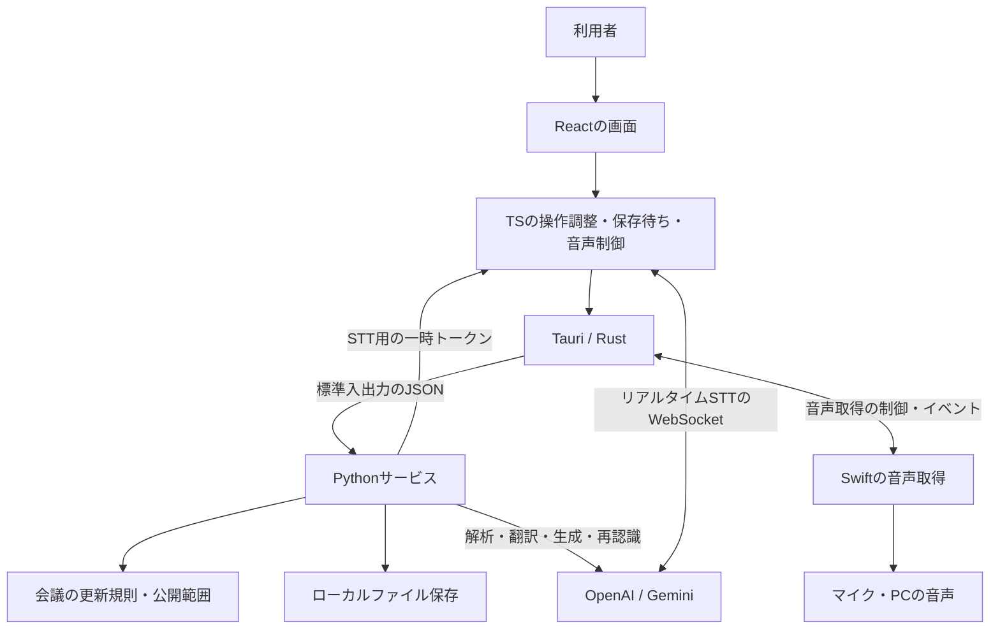

# ledadの内部設計

2026年10月8日時点の実装を整理した資料です。Python移行後のコードを対象に、現在の責務と、今後の拡張で変わる可能性がある境界を説明します。

## 1. 全体像

ledadは、**PythonでAI処理・会議データの更新規則・保存を担当し、ReactとTypeScriptで画面・音声の入出力・操作の進行を担当するMacアプリ**です。TauriとSwiftがmacOSとの接続を受け持ちます。

Next.jsは画面を作り、静的ファイルとして出力するために使っています。製品版では、そのファイルをTauriのWebViewが表示します。Next.jsのサーバーやNode.jsを常駐させる構成ではありません。



Pythonは「何を生成するか」「会議データをどう変更するか」を持ちます。ただし、**いつAIを呼ぶか、いつ機器を動かすかの調整は、まだ一部TSにあります**。全ロジックをPythonへ移した状態ではありません。

## 2. 責務とコードの置き場所

| 層 | 担当すること | 主な入口 |
| --- | --- | --- |
| Reactの画面 | 表示、入力、候補の選択・承認、画面切り替え | [SessionWorkspace.tsx](../../src/components/SessionWorkspace.tsx)、`src/components/` |
| Reactのhooks | 利用者の操作と非同期処理をつなぐ、処理中・エラー表示、開始・終了の順序 | [useMeeting.ts](../../src/hooks/useMeeting.ts)、`src/hooks/` |
| TSの保存調整 | 自動保存、書き込みの直列化、通信失敗後の再試行、応答待ち中の編集保持 | [persistence.ts](../../src/lib/session/persistence.ts) |
| TSの音声処理 | 音声送信、STT接続・再接続、再認識用バッファ、再生・停止・再開 | [listener.ts](../../src/lib/audio/listener.ts)、[speaker.ts](../../src/lib/audio/speaker.ts) |
| Pythonの操作窓口 | 入力検証、会議の読み込み、各処理への振り分け、応答・エラーの整形 | [service.py](../../backend/ledad/service.py) |
| Pythonの会議ルール | データ構造、開始・終了、候補・相談・発話の状態変更、公開範囲 | [models.py](../../backend/ledad/meeting/models.py)、[commands.py](../../backend/ledad/meeting/commands.py)、[policy.py](../../backend/ledad/meeting/policy.py) |
| PythonのAI処理 | 解析、翻訳、候補、相談、Insights、議事録、音声生成、録音再認識 | [tasks.py](../../backend/ledad/ai/tasks.py)、[gemini.py](../../backend/ledad/ai/gemini.py)、`ai/prompts/` |
| Pythonの保存処理 | 会議、資料、利用記録、診断ログのローカル保存 | [sessions.py](../../backend/ledad/storage/sessions.py)、`storage/` |
| Tauri / Rust | ウィンドウ、終了操作、Keychain、子プロセス管理、画面のアクセス制限 | [lib.rs](../../src-tauri/src/lib.rs)、[service.rs](../../src-tauri/src/service.rs) |
| Swift | macOSのマイク・システム音声取得、PCMへの変換 | [AudioCapture.swift](../../native/AudioCapture.swift) |

画面のディレクトリは「画面 → 大きいパーツ → 小さいパーツ」に沿っています。例えば会議画面には、`conversation`、`candidates`、`chat`、`presentation`、`controls`、`insights`があります。画面専用の表示処理はその近くに置き、複数の画面・処理が使う会議データの扱いは`src/lib/session/`へ置きます。

## 3. プロセスと通信

### 製品版のMacアプリ

通常のリクエストは次の経路です。

```text
React / TS
  → api.ts / desktop.ts
  → Tauriのservice_request
  → Pythonのtransport/stdio.py
  → service.py
  → meeting / ai / storage
```

Tauriが同梱Pythonサービスを起動し、標準入力・標準出力に1行ずつJSONを流します。本番のPythonサービスはlocalhostの待受ポートを開きません。`/api/...`という操作名は使いますが、本番ではHTTP通信ではありません。

- リクエストの`id`で並行処理の応答を対応付けます。
- 本文はJSON文字列、ファイルや応答バイナリはBase64で受け渡します。
- 取消はリクエストIDを指定して通知し、Pythonの実行中タスクへ伝えます。
- APIキーと保存先は、TauriからPythonへの初期化メッセージで渡します。

通信上のリクエストIDと、会議更新の二重適用を防ぐ`commandId`は別のものです。

### ブラウザでの開発

開発時は`desktop.ts`が`127.0.0.1:4319`のPython HTTPアダプターへ接続します。HTTPと標準入出力の両方が同じ`service.py`を呼ぶため、会議・AI処理を二重実装していません。HTTP側には接続元と入力サイズの検証があります。

### リアルタイムSTTだけの経路

[live-transcription.ts](../../src/lib/audio/live-transcription.ts)が、Pythonで発行した一時トークンを使ってGeminiへ直接WebSocket接続します。音声の逐次送信と接続更新はTSが担当します。Reactのコンポーネント内にWebSocket処理を埋め込んではいません。

録音をまとめて再認識する処理、翻訳、候補生成、相談、読み上げ音声の生成などはPythonを経由します。

## 4. 状態はどこが持つか

| 状態 | 保持する場所 | 保存・復元の扱い |
| --- | --- | --- |
| 会議名、設定、資料、原稿、確定した会話、候補、相談、発話記録、議事録、Insights | TSに作業中のコピー、Python側に保存済みのSession | ローカルJSONへ保存 |
| 選択中の候補、処理中表示、音量、接続状態、途中の認識・暫定訳 | React / TS | 実行中の表示用。会議本文としてそのまま保存しない |
| WebSocket、PCMバッファ、音声プレイヤー、取消ハンドル | TSの音声モジュールなど | 実行中のみ。再起動で復元しない |
| マイク・システム音声取得、Pythonプロセス | Rust / Swift | OSと実行プロセスが管理 |
| APIキー | macOS Keychain | Rustが読み、Pythonへ渡す。設定入力時を除き通常の画面APIへ実キーを返さない |

Session内でも、次の記録は役割が違います。

- **Transcript**：聞き取った発言。再認識後は、元の速報との対応を保持します。
- **Candidate**：これから話すための候補。候補を作っただけでは会議で発言したことになりません。
- **Chat**：「ledadに相談」の私的なやり取り。会議で話した内容とは区別します。
- **Utterance**：アプリが実際に再生した発話の記録。予定全文と再生完了を確認した文章を分けます。
- **Insights / Minutes**：会議の記録から導出する情報。未発話の候補や私的な相談を、実際の会議の発言として扱いません。

会議データの型は、TS側の[Zodスキーマ](../../src/lib/session/schema.ts)とPython側のPydanticモデルで定義しています。Pythonの入口で検証しますが、両言語の定義は手動で揃える構成です。自動生成された単一の型定義ではありません。

## 5. 主な処理の流れ

### 聞き取り → 速報 → 録音からの修正

1. Swiftが音声を取得し、Tauri経由でTSの`MeetingListener`へ渡します。
2. `LiveTranscription`が音声をGeminiへ送り、途中結果と確定したテキストを受け取ります。
3. TSが途中結果を表示します。途中翻訳は同時1件とし、待機中の原文を最新の内容へまとめます。
4. 確定したテキストをTSがSessionへ追加・保存し、Pythonへ翻訳と質問判定を依頼します。
5. `ReviewBuffer`が音声を区切り、Pythonへ録音再認識を依頼します。
6. Pythonの`refinement`コマンドが、元の発言ID・文章などを確認して修正版を反映します。応答待ち中に手動修正された内容などを無条件に上書きしません。

速報は反応の速さを、録音再認識は後から記録を整える役割を持ちます。再認識用の音声バッファはメモリ上で扱い、この経路では録音ファイルを会議資料として永続保存していません。

質問を検出した後、候補を自動生成するかの判定は現在`useMeeting.ts`に残っています。質問判定そのものはPythonですが、モード・設定・終了処理中かどうかを見て生成を始めるのはTSです。

### 候補生成 → 利用者の選択 → 発話

1. `useCandidateGeneration`が最新の編集を保存し、Pythonの候補生成を呼びます。
2. Pythonが会議の記録と利用可能な資料から候補を作ります。
3. `candidates`コマンドで候補をSessionへ登録します。
4. 利用者が候補を選び、発話操作を行います。選択だけでは再生しません。
5. `MeetingSpeaker`がPythonへ音声生成を依頼し、返った音声を再生します。
6. 再生の進行・完了・中断を`utterance`コマンドで記録します。

AIの出力と、利用者が承認して実際に話した内容を分ける構成です。「ledadに相談」は別経路で、`chat-start` → AIへの相談 → `chat-result`または`chat-failed`として記録します。

### 編集 → 保存 → 会議コマンド

[SessionPersistence](../../src/lib/session/persistence.ts)が、ローカル編集の保存とPythonへの会議コマンドを同じキューで順番に処理します。

1. フォーム編集などを画面へ即時反映し、250ms後に自動保存を予約します。
2. 保存の順番が来た時点のSessionを送ります。
3. 開始・終了・候補登録などは、Sessionのスナップショットと`commandId`を付けてPythonへ送ります。
4. Pythonが更新規則を適用し、Sessionと適用済みIDを同じファイルへ保存します。
5. 応答を待つ間に行われた追加編集を、返ってきたSessionへ再適用します。
6. 通信失敗などで結果が不明な場合は、次の書き込みに先立って同じ`commandId`で再試行します。

Pythonは直近128件の適用済みIDを保持します。同じIDを受け取った場合は再適用せず、現在のSessionを返します。ファイル保存は一時ファイルを書いて置き換えます。

これは**単一の編集画面で、保存順序と応答待ち中の編集を守る仕組み**です。複数端末・複数編集画面の同時更新を調停する仕組みではなく、無期限の二重実行防止やクラッシュ後の未送信編集の復旧も保証しません。

また、すべての編集が会議コマンドになったわけではありません。設定・原稿・速報・訳文・Insightsなどには、TSがSessionを編集してPUTする経路が残っています。

### 聞き取り停止・会議終了・アプリ終了

| 操作 | 動作 |
| --- | --- |
| 聞き取り停止 | 入力を止め、残った音声の処理と保存を待ちます。候補生成・相談・読み上げは続行できます |
| 会議終了 | 生成・相談などを取り消し、入力・再生を止めます。会議を終了状態にして、残りの再認識と保存を待ちます |
| ホームへ戻る・アプリ終了 | `prepareClose`で処理と音声を止め、保存を待ちます。この操作自体では会議の状態を終了へ変更しません |
| 会議を再度開く | `restore`で中断された再生・相談などの状態を整えます。音声機器の動作をそのまま復元する処理ではありません |

Macの終了操作は`menu.rs`と`useAppClose.ts`を通し、保存待ちにつなげています。OSによる強制終了まで保存を保証できるわけではありません。

## 6. Pythonの内部構成

```text
backend/ledad/
├── service.py          操作窓口。入力を検証し、各担当を呼ぶ
├── transport/          標準入出力 / 開発用HTTP / 入力形式
├── meeting/
│   ├── models.py       会議データの構造
│   ├── commands.py     会議の状態変更
│   ├── policy.py       生成・共有の公開範囲と会議の根拠データ
│   ├── documents.py    PDF・テキスト資料の抽出
│   └── pricing.py      会議開始時の単価と概算料金
├── ai/
│   ├── tasks.py        用途別のAI処理
│   ├── prompts/        用途別の指示文
│   ├── openai.py       OpenAI接続・構造化出力・利用記録
│   ├── gemini.py       一時トークン・音声生成・録音再認識
│   ├── retry.py        一時的な失敗の再試行
│   └── cache.py        プロンプトのキャッシュ用処理
└── storage/            会議・利用記録・診断の保存
```

`transport`は通信形式、`service.py`は処理の接続、`meeting`は会議のルール、`ai`はAIの使い方を持ちます。例えば`commands.py`は発話記録を反映しますが、スピーカーを操作しません。実際に機器で起きた結果を入力として受け取ります。

## 7. 公開範囲・保存先・外部送信

共有画面へは、Pythonの`public_view`が選んだ会議名・状態・ページ・字幕・共有可能な資料だけを渡します。Session全体を送って画面側で隠す構成ではありません。Rust側でも共有ウィンドウを自身の共有データ・スライドの取得に制限しています。

資料の「生成に使える」「内容を開示できる」「画面共有できる」は別の判断です。背景資料を候補生成に使う場合、まず限定された表現方針に変換し、最終候補の生成には公開可能な資料とその方針を渡します。これは非公開の事実を候補に混ぜないための設計ですが、モデル出力の完全な機密保持を保証するものではありません。

Macアプリのデータは`~/Library/Application Support/jp.ledad.desktop/`、通常の開発データは`.data/`、画面テストは`.data/e2e/`に保存します。会議データはローカルですが、利用するAI機能に応じて音声・文章・資料内容をOpenAIやGeminiへ送ります。オフライン完結のアプリではありません。

共有画面は現在、ローカルの別ウィンドウとして表示するものです。外部の参加者へインターネット経由で公開するWebサービスは、現在の実装には含みません。

## 8. 今後AIエージェントとして発展させる場合

現在は、画面の操作やTS側の更新処理をきっかけに、Pythonの用途別AI処理を呼ぶ構成です。自律的にツールを選んで繰り返し実行するエージェントや、アプリ再起動後も継続するジョブ基盤は未実装です。

機能を追加する際の置き場所は、次のように判断できます。

| 追加したい内容 | 基本的な置き場所 |
| --- | --- |
| 会話の理解、新しいAI処理、外部ツールの呼び出し | Pythonの`ai`。会議としての実行条件・状態変更は`meeting` |
| AI処理の進捗表示、利用者への確認・承認 | Reactの画面とhooks |
| 再生・録音・接続更新の改善 | TSの音声モジュール。macOS固有の取得処理はSwift / Rust |
| 新しい会議データの保存 | Pythonのモデルと保存処理。TS側のデータ契約も揃える |

画面を閉じても判断を続ける必要が出たら、現在TSにある「質問後に候補生成を始める」「会話の変化でInsightsを更新する」といった判断をPythonへ寄せるのが次の境界です。その時点で必要な実行状態や再開方法を追加します。

今の用途別関数と会議コマンドに処理を足すだけで済む機能なら、その構成のまま拡張できます。現段階で汎用エージェント基盤を追加する必要はありません。

## 9. 検証の分担

- [TSテスト](../../tests/)：音声接続・バッファ・再生、翻訳更新、保存順序、応答待ち中の編集、通信失敗後の再試行。
- [Pythonテスト](../../backend/tests/)：会議コマンド、公開範囲、資料、AI接続、再試行、料金、保存、通信入口。
- [画面E2E](../../tests/e2e/)：操作から生成結果・保存・共有表示までの画面の流れ。
- Macのビルド・同梱サービス検証：Python同梱、標準入出力の通信、署名と起動。

画面E2Eやビルド成功は、物理マイク・PC音声取得・macOS権限の確認とは別です。実機の音声取得には引き続き個別の確認が必要です。移行時の検証記録は[Python移行](20261008_Python移行.md)を参照してください。
